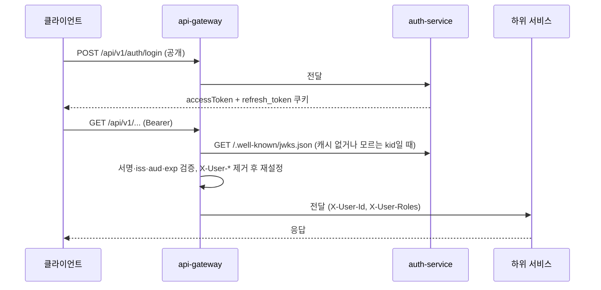

# Plan: SPEC-001 회원가입·로그인과 인증된 요청 — backend

- spec: docs 레포 `docs/specs/SPEC-001-auth-and-gateway/spec.md`
- 계약: docs 레포 `docs/contracts/openapi/auth-service.yaml`, `docs/contracts/openapi/_common.yaml`, `docs/contracts/auth/access-token.md`

## 1. 요약
- `services/auth-service`(Spring MVC, PostgreSQL)를 새로 만들어 가입, 로그인, 토큰 발급·회전·폐기, 공개키 목록(JWKS), 알림 티켓, 계정 잠금, 초기 관리자를 구현한다.
- `services/api-gateway`(Spring Cloud Gateway, WebFlux)를 새로 만들어 경로별 전달, JWKS 기반 토큰 검증, 사용자 헤더 전달, 오류 응답, CORS, 알림 티켓 검증, 요청 수 제한을 구현한다.
- 공통 오류 형식은 `libs/common-core`(오류 코드, `BusinessException`)와 `libs/common-web`(MVC용 ProblemDetail 핸들러)에 둔다. 게이트웨이는 WebFlux라서 자체 오류 핸들러를 둔다.
- 두 서비스는 저장소를 공유하지 않는다. 게이트웨이는 auth-service의 공개키 목록만 HTTP로 읽고, 티켓 1회용 처리는 게이트웨이 자기 Redis로 한다.

## 2. 담당 요구사항
| 요구사항 | 담당 모듈 / 컴포넌트 | 검증 테스트 |
| --- | --- | --- |
| R-1 | auth-service `SignUpService` | `SignUpApiTest` |
| R-2 | auth-service `SignUpService` | `SignUpApiTest` |
| R-3 | auth-service `SignUpRequest` 검증 | `SignUpApiTest` |
| R-4 | auth-service `PasswordPolicy` | `PasswordPolicyTest`, `SignUpApiTest` |
| R-5 | auth-service `SignUpRequest` 검증 | `SignUpApiTest` |
| R-6 | auth-service `PasswordHasher` | `SignUpApiTest` (저장값이 원문과 다르고 BCrypt로 일치) |
| R-7 | auth-service `LogInService`, `TokenIssuer` | `LogInApiTest` |
| R-8 | auth-service `LogInService` | `LogInApiTest` |
| R-9 | auth-service `LoginAuditRecorder` | `LogInApiTest` |
| R-10 | auth-service `MeController` | `MeApiTest` |
| R-11 | auth-service `JwksController`, `SigningKeys` | `JwksApiTest` |
| R-12 | api-gateway 라우트, `UserHeaderFilter` | `AuthenticatedRoutingTest` |
| R-13 | api-gateway `SecurityConfig` 공개 경로 | `PublicRoutingTest` |
| R-14 | api-gateway `ProblemAuthenticationEntryPoint` | `TokenRejectionTest` |
| R-15 | api-gateway JWT 검증기(`iss`, `aud`, 서명) | `TokenRejectionTest` |
| R-16 | api-gateway JWT 검증기(`exp`) | `TokenRejectionTest` |
| R-17 | api-gateway `UserHeaderFilter` | `HeaderSpoofingTest` |
| R-18 | api-gateway `GatewayErrorHandler` | `GatewayErrorTest` |
| R-19 | api-gateway 응답 시간 제한, `GatewayErrorHandler` | `GatewayErrorTest` |
| R-20 | api-gateway `GatewayErrorHandler` | `GatewayErrorTest` |
| R-21 | api-gateway CORS 설정 | `CorsTest` |
| R-22 | auth-service `TokenRefreshService` | `RefreshApiTest` |
| R-23 | auth-service `TokenRefreshService` | `RefreshApiTest` |
| R-24 | auth-service `TokenRefreshService` | `RefreshApiTest` |
| R-25 | auth-service `LogOutService` | `LogOutApiTest` |
| R-26 | auth-service `SseTicketIssuer` | `SseTicketApiTest` |
| R-27 | api-gateway `SseTicketFilter` | `SseTicketTest` |
| R-28 | api-gateway `SseTicketFilter` | `SseTicketTest` |
| R-29 | auth-service `User` 잠금 규칙 | `AccountLockTest`, `LogInApiTest` |
| R-30 | api-gateway 요청 수 제한 | `RateLimitTest` |
| R-31 | auth-service `InitialAdminCreator` | `InitialAdminTest` |
| NFR-1 | api-gateway | `GatewayLatencyTest` (WireMock 하위 서비스, p95 측정) |
| NFR-2 | auth-service 재발급 토큰 해시 저장 | `RefreshApiTest` (DB에 원문 없음) |
| NFR-3 | 두 서비스 로그 | `SensitiveLogTest` (출력 캡처에 토큰·비밀번호 없음) |
| NFR-4 | 두 서비스 오류 응답 | 각 오류 테스트에서 `application/problem+json`, `traceId` 확인 |
| NFR-5 | api-gateway JWKS 캐시·재조회 | `KeyRotationTest` |

## 3. 원칙 점검
| 원칙 | 준수 | 비고 |
| --- | --- | --- |
| I 스펙 우선 — spec이 Approved 상태인가 | ☑ | SPEC-001 Approved (docs #7) |
| II 계약 우선 — 계약 변경이 먼저 머지됐는가 | ☑ | docs #8(API·토큰), #9(티켓) 머지 |
| III 테스트 우선 — 모든 R-*에 테스트가 매핑되고, 태스크가 요구사항 단위 TDD 사이클로 나뉘었는가 | ☑ | R-1~R-31, NFR-1~5 매핑. tasks.md 참고 |
| IV 서비스 자율성 — 다른 서비스 DB나 코드에 직접 의존하지 않는가 | ☑ | 게이트웨이는 JWKS HTTP만 사용. 티켓 1회용 처리는 게이트웨이 Redis. 두 서비스 간 import 없음(ArchUnit) |
| V 단순성 — 새 의존성이나 추상화가 정당한가 | ☑ | Spring Boot·Cloud BOM 관리 라이브러리만 사용. 사용자 승인 받음(6절). 새 서비스 모듈은 ADR-0003 |
| VI 관측 가능성 — 로그, 추적, health를 갖췄는가 | ☑ | Actuator health, Micrometer Tracing(`traceparent`), JSON 로그, ProblemDetail `traceId` |
| VII 보안 — 입력 검증, 인가, 비밀값 처리를 했는가 | ☑ | Bean Validation, BCrypt, 토큰·티켓 해시 저장, 개인키는 환경변수/Secrets Manager, 위조 헤더 제거 |
| VIII 문서·주석 — spec·계약·plan과 구현이 일치하고, 주석이 왜를 설명하는가 | ☑ | 계약 테스트(T050), 구현 중 차이가 생기면 docs PR 먼저 |
| IX GitOps — AWS 변경은 infra, 클러스터 변경은 gitops 레포를 거치는가 | ☑ | 배포 매니페스트는 gitops `apps/{auth-service,api-gateway}`, Secrets Manager 경로는 infra (이 plan 범위 밖, 8절) |

## 4. 기술 설계

### 변경 대상
| 경로 | 변경 |
| --- | --- |
| `settings.gradle.kts` | `services:auth-service`, `services:api-gateway` 추가 |
| `gradle/libs.versions.toml`, `build-logic` | WireMock, Testcontainers(Boot BOM 관리), JSpecify(`@Nullable`, java-style.md) 추가 |
| `libs/common-core` | `ErrorCode` 인터페이스, `BusinessException` |
| `libs/common-web` | MVC용 `ProblemDetailExceptionHandler`(`code`, `traceId` 포함), Bean Validation 오류 변환 |
| `services/auth-service` | 새 모듈. 패키지 `com.vlm.auth.{api,application,domain,infra}` |
| `services/api-gateway` | 새 모듈. 패키지 `com.vlm.gateway.{config,filter,error}` |

### auth-service 구성
- **가입**: 이메일 소문자 정규화 후 중복 확인 → 비밀번호 정책 → BCrypt(strength 10) 해시 → `users` 저장. 이메일 유니크 제약으로 동시 가입 경쟁도 409로 변환한다.
- **로그인**: 사용자 조회 → 잠금 확인(423) → 비밀번호 확인 → 실패 시 실패 횟수 증가(5회째에 `locked_until = now + 15분`) / 성공 시 초기화 → 로그인 기록 → 토큰 발급.
  - 이메일이 없을 때도 BCrypt 비교를 한 번 수행해 응답 시간으로 계정 존재 여부가 드러나지 않게 한다.
- **접근 토큰**: `NimbusJwtEncoder` + EC P-256 키. 헤더 `kid`, 클레임은 `access-token.md` 그대로. `iss`는 환경변수.
- **재발급 토큰**: 256비트 난수(base64url). DB에는 SHA-256 해시만 저장. 로그인마다 새 `family_id`를 만들고, 재발급할 때 같은 family로 새 토큰을 만들며 이전 토큰에 `used_at`을 기록한다.
  - `used_at`이 있는 토큰이 다시 오면 그 family 전체에 `revoked_at`을 기록하고 401 `AUTH_REFRESH_REUSED`.
  - 쿠키: `refresh_token`, `Path=/api/v1/auth`, `HttpOnly`, `Secure`, `SameSite=Strict`, `Max-Age=1209600`.
- **JWKS**: 현재 서명 키의 공개키 + 환경변수로 지정한 이전 공개키(선택)를 반환한다. 개인키는 응답에 넣지 않는다.
- **알림 티켓**: 같은 서명 키로 `aud: vlm-sse`, 30초 JWT를 발급한다. 저장하지 않는다.
- **내 정보**: `X-User-Id`(UUID)로 사용자를 조회한다. 게이트웨이가 넣은 헤더를 신뢰하며, NetworkPolicy로 게이트웨이 외 접근을 막는다(gitops).
- **초기 관리자**: `ApplicationRunner`. ADMIN이 없고 `AUTH_ADMIN_EMAIL`·`AUTH_ADMIN_PASSWORD`가 있으면 생성한다. 값이 없으면 경고 로그만 남기고 건너뛴다(로컬 편의).

### api-gateway 구성
- **라우트**: `/api/v1/auth/**` → auth-service, `/api/v1/media/**` → media-service, `/api/v1/jobs/**` → pipeline-service, `/api/v1/analysis/**` → analysis-api, `/api/v1/search/**` → search-service, `/api/v1/notify/**` → notification-service. 대상 주소는 환경변수다. 아직 없는 서비스는 503이 정상이다.
- **인증**: Spring Security WebFlux resource server. `NimbusReactiveJwtDecoder.withJwkSetUri(...)`에 검증기 `iss`·`aud(vlm-api)`·시간(허용 오차 30초)을 건다. 알고리즘은 ES256만 허용한다.
  - 공개 경로: `POST /api/v1/auth/{signup,login,refresh}`, `GET /actuator/health/**`. 나머지 `/api/**`는 인증 필요.
  - 실패 응답은 `ServerAuthenticationEntryPoint`에서 ProblemDetail로 만든다. 토큰 없음 / 만료(`JwtValidationException` 중 `exp`) / 그 밖의 실패를 `AUTH_TOKEN_MISSING` / `AUTH_TOKEN_EXPIRED` / `AUTH_TOKEN_INVALID`로 나눈다.
- **사용자 헤더**: 모든 요청에서 `X-User-Id`, `X-User-Roles`를 먼저 지운 뒤(R-17), 인증된 요청에만 `sub`·`roles`로 다시 넣는다(R-12).
- **오류**: `ErrorWebExceptionHandler`로 라우트 없음 404, 응답 시간 초과 504(`spring.cloud.gateway.httpclient.response-timeout`), 연결 실패 503을 ProblemDetail로 바꾼다.
- **CORS**: `spring.cloud.gateway.globalcors`, 허용 출처는 환경변수(frontend 주소), `allowCredentials=true`(재발급 쿠키).
- **알림 티켓**: `/api/v1/notify/stream` 전용 필터. `?ticket` JWT를 `aud: vlm-sse` 검증기로 확인하고, Redis `SET sse:jti:<jti> 1 NX EX 60`이 실패하면(이미 사용) 401.
- **요청 수 제한**: `RequestRateLimiter` + `RedisRateLimiter`, 키는 클라이언트 IP. 분당 10회는 `replenishRate=1, burstCapacity=60, requestedTokens=6`으로 표현한다. 거절 응답을 ProblemDetail로 바꾼다.
  - IP는 ALB가 붙인 `X-Forwarded-For`의 마지막 신뢰 홉을 쓴다(`forwarded-headers-strategy`). 로컬은 원격 주소.

### 데이터 모델 (auth_db)
마이그레이션: `V202611021200__create_auth_tables.sql`

| 테이블 | 컬럼 | 비고 |
| --- | --- | --- |
| `users` | `id BIGINT IDENTITY PK`, `public_id UUID UNIQUE NOT NULL`, `email VARCHAR(254) UNIQUE NOT NULL`, `password_hash VARCHAR(100) NOT NULL`, `nickname VARCHAR(20) NOT NULL`, `role VARCHAR(20) NOT NULL`, `failed_login_count INT NOT NULL DEFAULT 0`, `locked_until TIMESTAMPTZ NULL`, `created_at`, `updated_at` | 외부에는 `public_id`만 노출(토큰 `sub`, `X-User-Id`, API `id`). 역할은 하나이며 API에서는 배열로 반환 |
| `refresh_tokens` | `id BIGINT IDENTITY PK`, `user_id BIGINT NOT NULL REFERENCES users`, `family_id UUID NOT NULL`, `token_hash CHAR(64) UNIQUE NOT NULL`, `expires_at TIMESTAMPTZ NOT NULL`, `used_at TIMESTAMPTZ NULL`, `revoked_at TIMESTAMPTZ NULL`, `created_at`, `updated_at` | 인덱스 `(family_id)` |
| `login_audits` | `id BIGINT IDENTITY PK`, `user_id BIGINT NULL`, `success BOOLEAN NOT NULL`, `client_ip VARCHAR(45) NOT NULL`, `occurred_at TIMESTAMPTZ NOT NULL`, `created_at`, `updated_at` | 없는 이메일이면 `user_id` NULL. 시도한 이메일 원문은 저장하지 않음 |

### API / 이벤트
- auth-service: `signUp`, `logIn`, `refreshToken`, `logOut`, `getMe`, `issueSseTicket`, `getJwks` (`auth-service.yaml` 1.0.1)
- api-gateway: 자체 API 없음. `_common.yaml`의 `XUserId`, `XUserRoles`, `Unauthenticated`, `RateLimited`, `GatewayError`를 따른다.
- 이벤트: 해당 없음

### 상호작용

## 5. 대안과 선택 이유
| 대안 | 장점 | 단점 | 선택 |
| --- | --- | --- | --- |
| 사용자 ID: BIGINT PK + 외부용 UUID | persistence 규칙·계약 모두 유지, 순번 비노출 | 컬럼 하나 추가 | ☑ (사용자 결정) |
| 사용자 ID: UUID PK | 컬럼 하나 | persistence 규칙 예외 필요 | |
| 알림 티켓: 서명된 단기 JWT + 게이트웨이 Redis로 1회용 | 저장소 공유 없음(원칙 IV), 기존 JWKS 재사용 | 게이트웨이에 Redis 필요 | ☑ (사용자 결정, 계약 docs #9) |
| 알림 티켓: 공유 Redis 난수 | 단순 | 두 서비스가 저장소 공유 | |
| 비밀번호 해시: BCrypt | Spring Security 기본, 추가 의존성 없음 | Argon2보다 메모리 하드하지 않음 | ☑ (사용자 결정) |
| 토큰 서명: `spring-security-oauth2-jose`(Nimbus) | 게이트웨이 검증과 같은 라이브러리, BOM 관리 | — | ☑ |
| 토큰 서명: Authorization Server 도입 | 표준 OAuth2 엔드포인트 | 이번 요구사항에 비해 과함(원칙 V) | |

되돌리기 어렵거나 다른 레포에 영향을 주는 결정은 없다. 토큰 형식은 이미 계약으로 확정됐다.

## 6. 테스트 전략
- **새 라이브러리 (사용자 승인)**: gateway `spring-cloud-starter-gateway-server-webflux`(Spring Cloud 2025.0부터 이 이름), `spring-boot-starter-oauth2-resource-server`, `spring-boot-starter-data-redis-reactive` / auth `spring-boot-starter-{web,data-jpa,validation}`, `flyway-core`, `flyway-database-postgresql`, `postgresql`, `spring-security-crypto`, `spring-security-oauth2-jose` / 테스트 `org.testcontainers:{postgresql,junit-jupiter}`, `com.redis:testcontainers-redis` 또는 GenericContainer, `org.wiremock:wiremock-standalone`
- **단위**: `PasswordPolicy`, `User` 잠금 규칙(시계 주입), 재발급 토큰 회전 규칙
- **통합 (auth-service)**: `@SpringBootTest` + Testcontainers PostgreSQL(`@ServiceConnection`) + MockMvc. 요구사항마다 API 테스트
- **통합 (api-gateway)**: `@SpringBootTest(RANDOM_PORT)` + `WebTestClient`. 하위 서비스와 JWKS는 WireMock, 테스트 키 쌍으로 토큰을 직접 서명. P2는 Testcontainers Redis
- **계약**: auth-service 응답을 `auth-service.yaml` 스키마로 검증(T050). 테스트 이름은 `@DisplayName("[SPEC-001 R-n] ...")`
- **아키텍처**: 서비스마다 ArchUnit(`api → application → domain ← infra`, 서비스 간 import 금지, `GeneralCodingRules`). 게이트웨이는 레이어 대신 패키지 간 순환 금지만 검사
- **E2E**: 로컬 compose에서 가입 → 로그인 → 게이트웨이 경유 `/me` 수동 시연 (성공 지표)

## 7. 리스크와 롤백
- 리스크
  - Spring Boot 3.5는 무료 지원이 끝나 보안 패치가 없다. 의존성 취약점은 CI에서 확인하고, 4.x 전환은 별도 ADR로 다룬다.
  - 게이트웨이 앞단(ALB)의 `X-Forwarded-For` 처리가 잘못되면 IP 제한이 모든 사용자를 하나로 묶을 수 있다. dev 배포 때 확인한다.
  - 서명 키 유출 시 모든 토큰 위조 가능. 키는 Secrets Manager에만 두고 교체 절차(`access-token.md`)를 따른다.
- 롤백 방법: 두 서비스 모두 신규라 이전 이미지로 되돌리거나 gitops에서 Application을 내리면 된다. 마이그레이션은 신규 테이블 생성뿐이다.

## 8. 배포 고려사항
- **환경변수** (레포 `.env.example`, 루트 `local/.env.example`에 반영)
  - auth-service: `AUTH_DB_URL`, `AUTH_DB_USERNAME`, `AUTH_DB_PASSWORD`, `AUTH_JWT_ISSUER`, `AUTH_JWT_KEY_ID`, `AUTH_JWT_PRIVATE_KEY`(PEM, 비밀값), `AUTH_JWT_PREVIOUS_PUBLIC_KEYS`(선택), `AUTH_ADMIN_EMAIL`, `AUTH_ADMIN_PASSWORD`(비밀값)
  - api-gateway: `GATEWAY_JWKS_URI`, `GATEWAY_JWT_ISSUER`, `GATEWAY_CORS_ALLOWED_ORIGINS`, `GATEWAY_REDIS_HOST`, `GATEWAY_REDIS_PORT`, 서비스별 `*_SERVICE_URI`
- **로컬 compose** (docs 레포 `local/`): PostgreSQL(auth_db), Redis, auth-service(8081), api-gateway(8080). 별도 docs PR로 추가한다.
- **운영**: Secrets Manager 경로(infra), gitops `apps/{auth-service,api-gateway}/base` 매니페스트와 auth-service NetworkPolicy(게이트웨이만 허용)는 각 레포 PR로 한다.
- **배포 순서**: auth-service → api-gateway (게이트웨이가 시작할 때 JWKS를 읽을 수 있어야 함).
