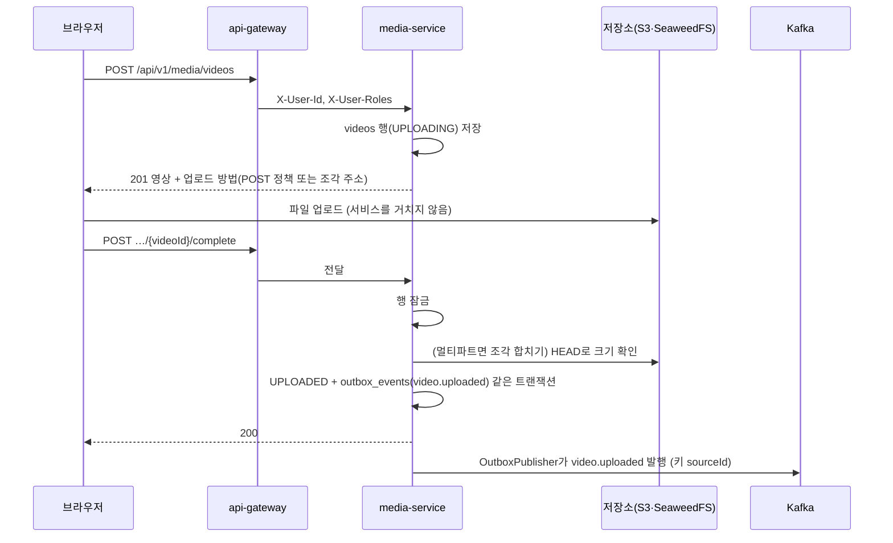

# Plan: SPEC-003 영상 업로드와 관리 — backend

- spec: docs 레포 `docs/specs/SPEC-003-video-upload/spec.md`
- 계약: docs 레포 `docs/contracts/openapi/media-service.yaml`, `docs/contracts/asyncapi/media-service.yaml`, `docs/contracts/events/{_envelope,video.uploaded,video.deleted}.schema.json`
- ADR: ADR-0002(Kafka), ADR-0005(서비스 구성), ADR-0006(로컬·테스트 S3 대체 SeaweedFS)

## 1. 요약

- `services/media-service`(Spring MVC, PostgreSQL `media_db`)를 새로 만들어 업로드 자리 발급, 업로드 완료 확인, 만료, 목록·상세, 삭제를 구현한다.
- 영상 바이트는 서비스를 거치지 않는다. 단일 업로드는 직접 서명한 SigV4 POST 정책, 멀티파트는 AWS SDK v2의 조각별 서명 PUT 주소로 브라우저가 저장소에 바로 올린다.
- 상태 변경과 이벤트 기록은 한 트랜잭션에서 한다(Outbox). Outbox 기록·발행은 도메인 로직이 없는 공통 코드라 `libs/common-messaging`에 두고, 이후 서비스가 같이 쓴다.
- 만료와 저장소 정리는 주기 작업이 `FOR UPDATE SKIP LOCKED`로 행을 나눠 가져가 여러 Pod에서도 한 번만 처리한다.

## 2. 담당 요구사항

경로 약어: `M` = `services/media-service/src`, `CM` = `libs/common-messaging/src`

| 요구사항 | 담당 모듈 / 컴포넌트 | 검증 테스트 |
| --- | --- | --- |
| R-1 | `api/VideoController`, `application/CreateVideoService`, `domain/Video` | `CreateVideoApiTest` |
| R-2 | `infra/storage/PostPolicySigner`, `S3UploadStorage` | `SingleUploadTest`(SeaweedFS에 실제 POST: 같은 크기 204, 다른 크기 거절) |
| R-3 | `S3UploadStorage`(멀티파트 시작, 조각 주소 서명), `domain/UploadPlan` | `MultipartUploadTest` |
| R-4 | `api/CreateVideoRequest` 검증, `domain/VideoFilePolicy` | `CreateVideoApiTest` |
| R-5 | `domain/VideoFilePolicy`(확장자·MIME 짝) | `VideoFilePolicyTest`, `CreateVideoApiTest` |
| R-6 | `domain/StorageKey` | `CreateVideoApiTest`(저장 키가 `sources/<videoId>/original`) |
| R-7 | `application/CompleteUploadService` | `CompleteUploadApiTest` |
| R-8 | `CompleteUploadService`, `S3UploadStorage`(조각 합치기) | `MultipartUploadTest` |
| R-9 | `CompleteUploadService` + `OutboxRecorder` | `VideoUploadedEventTest` |
| R-10 | `CompleteUploadService` | `CompleteUploadApiTest` |
| R-11 | `CompleteUploadService` | `CompleteUploadApiTest` |
| R-12 | `domain/Video` 상태 전이 | `VideoTest`, `CompleteUploadApiTest` |
| R-13 | `application/UploadExpiryJob`, `StorageCleanupJob` | `UploadExpiryTest` |
| R-14 | `application/VideoQueryService`, `infra/persistence` | `ListVideosApiTest` |
| R-15 | `VideoQueryService` | `GetVideoApiTest` |
| R-16 | `domain/VideoAccess` | `GetVideoApiTest`, `DeleteVideoApiTest` |
| R-17 | `domain/VideoAccess` | `GetVideoApiTest`, `DeleteVideoApiTest` |
| R-18 | `application/DeleteVideoService` | `DeleteVideoApiTest` |
| R-19 | `DeleteVideoService` + `OutboxRecorder` | `VideoDeletedEventTest` |
| R-20 | `StorageCleanupJob` | `StorageCleanupTest` |
| R-21 | `application/event/VideoEvents` | `VideoUploadedEventTest`, `VideoDeletedEventTest`(JSON Schema로 검증) |
| NFR-1 | 업로드 바이트를 받는 엔드포인트 없음 | `NoUploadBytesTest`(multipart/form-data 요청 거절, 컨트롤러에 바이트 본문 없음) |
| NFR-2 | `CompleteUploadService`(영상 행 잠금) | `ConcurrentCompleteTest`(10건 동시) |
| NFR-3 | `CM` `OutboxPublisher` | `OutboxPublisherTest`(Testcontainers Kafka: 10초 안 발행, 재시도 시 같은 eventId) |
| NFR-4 | 전체 | `MediaLatencyTest` |
| NFR-5 | 로그 | `SensitiveLogTest` |
| NFR-6 | `PostPolicySigner`, `S3UploadStorage` | `SingleUploadTest`, `MultipartUploadTest`(만료 시각과 서명 유효기간 3600초) |

## 3. 원칙 점검

| 원칙 | 준수 | 비고 |
| --- | --- | --- |
| I 스펙 우선 — spec이 Approved 상태인가 | ☑ | SPEC-003 Approved (docs #26) |
| II 계약 우선 — 계약 변경이 먼저 머지됐는가 | ☑ | docs #27(REST·이벤트 계약) 머지 |
| III 테스트 우선 — 모든 R-*에 테스트가 매핑되고, 태스크가 요구사항 단위 TDD 사이클로 나뉘었는가 | ☑ | R-1~R-21, NFR-1~6 매핑. tasks.md 참고 |
| IV 서비스 자율성 — 다른 서비스 DB나 코드에 직접 의존하지 않는가 | ☑ | 자기 DB(`media_db`)만 쓴다. 다른 서비스와는 Kafka 이벤트로만 통신. Outbox는 도메인 없는 `libs/common-messaging` |
| V 단순성 — 새 의존성이나 추상화가 정당한가 | ☑ | AWS SDK v2(S3), spring-kafka, 테스트용 Testcontainers Kafka·JSON Schema 검증기(사용자 승인). POST 정책 서명은 SDK가 지원하지 않아 직접 구현(사용자 결정). 분산 락 라이브러리 대신 `SKIP LOCKED` |
| VI 관측 가능성 — 로그, 추적, health를 갖췄는가 | ☑ | Actuator health, `traceparent`를 Outbox에 저장해 Kafka 헤더로 이어 보냄, ProblemDetail `traceId` |
| VII 보안 — 입력 검증, 인가, 비밀값 처리를 했는가 | ☑ | Bean Validation, 확장자·MIME 짝 검사, 저장 경로에 사용자 파일 이름 미사용, 소유자·ADMIN 인가, 업로드 주소 로그 금지, 접근 키는 환경변수(운영은 IRSA) |
| VIII 문서·주석 — spec·계약·plan과 구현이 일치하고, 주석이 왜를 설명하는가 | ☑ | REST 계약 테스트(swagger-request-validator), 이벤트는 JSON Schema 검증 |
| IX GitOps — AWS 변경은 infra, 클러스터 변경은 gitops 레포를 거치는가 | ☑ | S3 버킷·IAM은 infra, 매니페스트는 gitops (이 plan 범위 밖, 8절) |

## 4. 기술 설계

### 변경 대상

| 경로 | 변경 |
| --- | --- |
| `gradle/libs.versions.toml` | AWS SDK BOM 2.57.8, `testcontainers-kafka`, `json-schema-validator`(테스트) 추가. spring-kafka는 Boot BOM 관리 |
| `libs/common-messaging` | Outbox 기록(`OutboxRecorder`)과 발행(`OutboxPublisher`), 이벤트 공통 필드 |
| `services/media-service` | 새 모듈 |
| `settings.gradle.kts` | `services:media-service` 등록 |
| `.env.example`, `README.md` | media-service 환경변수와 로컬 실행 |
| docs 레포 `local/` | Kafka(KRaft), SeaweedFS(+버킷·접근 키), media_db, media-service 추가 (별도 docs PR) |

### media-service 구성

- **패키지**: `com.vlm.media.{api,application,domain,infra}`. 의존 방향 `api → application → domain ← infra`를 ArchUnit으로 강제한다.
- **업로드 자리 발급** (`POST /api/v1/media/videos`)
  - 확장자와 MIME 짝(mp4↔`video/mp4`, mov↔`video/quicktime`, mkv↔`video/x-matroska`, avi↔`video/x-msvideo`)과 크기(1~5GB)를 검사한다. 확장자는 대소문자를 구분하지 않는다.
  - 영상 ID(UUID)를 먼저 만들고 저장 키를 `sources/<videoId>/original`로 정한다. 파일 이름은 표시용 컬럼에만 둔다.
  - 100MB(104,857,600바이트) 이하: `PostPolicySigner`가 `content-length-range=[size,size]`, `key`, `Content-Type`, 만료 1시간 조건으로 SigV4 정책을 서명해 `url`과 `fields`를 돌려준다.
  - 초과: `CreateMultipartUpload`를 호출하고 `upload_id`를 저장한 뒤 조각 수(`ceil(size / 64MiB)`, 최대 80개)만큼 `UploadPart` 서명 주소(1시간)를 만든다. 조각 크기 64MiB는 S3 최소 조각(5MiB)과 최대 조각 수(10,000) 사이에서, 5GB를 80번 안에 올리고 실패 시 다시 올릴 양을 줄이는 값이다.
  - 저장소 클라이언트는 두 개다. 서버 호출용(내부 주소)과 서명용(브라우저가 닿는 공개 주소). 로컬에서는 compose 안의 주소와 `localhost` 주소가 다르기 때문이다. 운영에서는 둘 다 S3 기본 주소다.

### 저장소 교체 방식 (로컬 SeaweedFS ↔ 운영 S3)

SeaweedFS가 S3 API를 그대로 제공하므로 저장소별 구현이나 모듈을 따로 두지 않는다. 구현은 AWS SDK v2를 쓰는 `infra/storage/S3UploadStorage` 하나이고, 환경변수만 바꿔 저장소를 고른다. 코드에 `seaweedfs`나 `local` 분기를 두지 않는다.

| 설정 | 로컬 compose (SeaweedFS) | 운영 (S3) |
| --- | --- | --- |
| `MEDIA_S3_ENDPOINT` (서버 호출) | `http://seaweedfs:8333` | 비움 → SDK가 리전 기본 주소 사용 |
| `MEDIA_S3_PUBLIC_ENDPOINT` (서명) | `http://localhost:8333` | 비움 → 서버 호출과 같은 기본 주소 |
| `MEDIA_S3_PATH_STYLE` | `true` | `false` (가상 호스트 방식) |
| `MEDIA_S3_REGION` | `us-east-1` (SeaweedFS는 값만 맞으면 됨) | `ap-northeast-2` |
| `MEDIA_S3_BUCKET` | `vlm-media` | infra가 만든 버킷 이름 |
| 접근 키 | `AWS_ACCESS_KEY_ID`·`AWS_SECRET_ACCESS_KEY`에 로컬 샘플 키 | 넣지 않음 → SDK 기본 자격 증명 체인이 IRSA 역할을 씀 |

- 애플리케이션은 도메인의 `UploadStorage` 인터페이스만 쓴다. 저장소 종류를 바꿀 일이 생기면 이 인터페이스의 구현만 바꾸면 되지만, 지금은 구현이 하나다(원칙 V).
- POST 정책 서명(`PostPolicySigner`)도 같은 자격 증명 체인에서 키를 받아 서명하므로 로컬·운영 코드가 같다. 운영의 IRSA 임시 자격 증명은 세션 토큰을 함께 써야 해서 정책과 폼 필드에 `x-amz-security-token`을 넣는다(값이 있을 때만).
- 통합 테스트는 SeaweedFS 컨테이너 주소를 같은 설정 키로 넣어, 운영과 같은 코드 경로를 검증한다.
- **업로드 완료** (`POST …/{videoId}/complete`)
  - 한 트랜잭션에서 영상 행을 `SELECT … FOR UPDATE`로 잠근다. 같은 영상의 동시 요청은 순서대로 처리돼 상태 전이와 이벤트가 한 번만 일어난다(NFR-2).
  - 이미 `UPLOADED`면 그대로 200(R-11). `EXPIRED`·`DELETED`면 409 `MEDIA_INVALID_STATE`(R-12).
  - 멀티파트면 `parts`로 `CompleteMultipartUpload`를 호출한다. 그 뒤(단일이면 바로) `HeadObject`로 크기를 확인해 다르거나 없으면 409 `MEDIA_UPLOAD_INCOMPLETE`(R-10).
  - 저장소 호출이 행 잠금 안에 들어간다. 잠금은 영상 하나에만 걸리고 같은 영상의 완료 요청끼리만 기다리므로 받아들인다. 운영 S3의 조각 합치기가 게이트웨이 응답 제한(10초)을 넘는지는 dev에서 확인한다(7절).
  - 성공하면 `UPLOADED`, `uploaded_at` 기록, `OutboxRecorder`로 `video.uploaded`를 같은 트랜잭션에 기록한다(R-9, R-21).
- **목록·상세** (`GET …/videos`, `GET …/{videoId}`): `owner_id = X-User-Id`이고 `DELETED`가 아닌 행. 정렬은 `created_at DESC, id DESC` 고정이라 정렬 파라미터는 받지 않는다. `size`는 1~100.
- **권한** (`domain/VideoAccess`): 소유자이거나 `X-User-Roles`에 `ADMIN`이 있으면 상세·삭제를 허용한다. 완료 요청은 소유자만. 거절은 모두 404 `MEDIA_VIDEO_NOT_FOUND`(R-16, R-17).
- **삭제** (`DELETE …/{videoId}`): 행 잠금 → `DELETED`, `deleted_at` 기록, `video.deleted` Outbox 기록 → 204. 저장소 파일은 주기 작업이 지운다(R-20).
- **주기 작업**
  - `UploadExpiryJob`(5분): `UPLOADING`이고 `expires_at < now`인 행을 `FOR UPDATE SKIP LOCKED LIMIT 100`으로 가져가 `EXPIRED`로 바꾼다. `expires_at = created_at + 24시간`.
  - `StorageCleanupJob`(1분): `EXPIRED`·`DELETED`이고 `storage_cleaned_at IS NULL`인 행을 같은 방식으로 가져가, 끝나지 않은 멀티파트를 취소하고 `sources/<videoId>/` 접두사의 객체를 지운 뒤 `storage_cleaned_at`을 기록한다. 실패하면 기록하지 않아 다음 주기에 다시 시도한다.
  - 두 작업 모두 시계(`Clock`)를 주입해 테스트에서 시간을 옮긴다. `SKIP LOCKED`라서 여러 Pod가 같은 행을 두 번 처리하지 않으므로 분산 락 라이브러리를 쓰지 않는다.

### common-messaging (Outbox)

- `OutboxRecorder.record(eventType, aggregateId, payload)`: 현재 트랜잭션에 `outbox_events` 행을 넣는다. `event_id`(UUID)는 여기서 정하고 재시도해도 바뀌지 않는다. 현재 `traceparent`도 같이 저장한다.
- `OutboxPublisher`(1초 주기): `published_at IS NULL` 행을 `ORDER BY id FOR UPDATE SKIP LOCKED LIMIT 100`으로 가져가 Kafka로 보낸다(토픽 = `event_type`, 키 = `aggregate_id`, 헤더 `traceparent`). 전송이 확인되면 `published_at`을 기록하고, 실패하면 `attempts`를 올리고 다음 주기에 다시 보낸다.
  - 한 영상의 행이 서로 다른 Pod로 나뉘어 순서가 뒤바뀔 수 있다. media-service가 같은 영상에 내는 이벤트는 `video.uploaded`와 `video.deleted` 두 개뿐이고, 소비자는 계약대로 삭제 흔적으로 순서를 다룬다(`video.deleted.schema.json` 설명). 아키텍처 개요의 "sourceId 단위로 묶어 가져가기"는 이벤트 종류가 늘어나는 pipeline-service 때 넣는다.
- 테이블은 라이브러리가 만들지 않는다. 각 서비스 마이그레이션이 같은 구조로 만든다(DB는 서비스마다 따로라서).

### 데이터 모델 (media_db)

마이그레이션 `V202611031200__create_media_tables.sql` (사용자 승인)

| 테이블 | 컬럼 |
| --- | --- |
| `videos` | `id BIGINT IDENTITY PK`, `public_id UUID UNIQUE`(외부 노출 ID), `owner_id UUID`, `file_name VARCHAR(255)`, `size_bytes BIGINT`, `content_type VARCHAR(40)`, `status VARCHAR(20)`, `storage_key VARCHAR(200)`, `multipart_upload_id VARCHAR(1024)`(단일이면 NULL), `part_size_bytes BIGINT`, `expires_at`, `uploaded_at`, `deleted_at`, `storage_cleaned_at`, `created_at`, `updated_at` (`TIMESTAMPTZ`) |
| `outbox_events` | `id BIGINT IDENTITY PK`, `event_id UUID UNIQUE`, `event_type VARCHAR(100)`, `aggregate_id UUID`, `payload JSONB`, `trace_parent VARCHAR(55)`, `attempts INT DEFAULT 0`, `published_at`, `created_at`, `updated_at` |

- 인덱스: `videos(owner_id, created_at DESC) WHERE status <> 'DELETED'`(목록), `videos(expires_at) WHERE status = 'UPLOADING'`(만료), `videos(id) WHERE storage_cleaned_at IS NULL AND status IN ('EXPIRED','DELETED')`(정리), `outbox_events(id) WHERE published_at IS NULL`(발행)
- `owner_id`는 auth-service의 사용자 UUID 값만 저장한다(다른 서비스 FK 없음).

### API / 이벤트

- REST: `createVideo`, `listVideos`, `getVideo`, `deleteVideo`, `completeVideoUpload` (`media-service.yaml` 1.0.0)
- 이벤트: `video.uploaded`, `video.deleted` (`asyncapi/media-service.yaml` 1.0.0). payload는 Jackson으로 직렬화한 record

### 상호작용

## 5. 대안과 선택 이유

| 대안 | 장점 | 단점 | 선택 |
| --- | --- | --- | --- |
| 단일 업로드: SigV4 POST 정책 직접 서명 | 계약 그대로, 의존성 추가 없음 | 서명 코드를 직접 유지 | ☑ (사용자 결정). SeaweedFS 통합 테스트로 실제 수락·거절을 확인 |
| 단일 업로드: MinIO Java SDK PostPolicy | 서명 코드 없음 | S3 클라이언트가 두 개 | |
| 단일 업로드: 서명 PUT으로 계약 변경 | SDK만으로 됨 | 방금 머지한 계약의 하위호환 파괴 | |
| 완료 동시성: 영상 행 비관적 잠금 | 구현이 단순하고 저장소 호출까지 한 번만 | 저장소 호출 동안 행 잠금 | ☑ |
| 완료 동시성: 조건부 UPDATE만 | 잠금 시간이 짧음 | 멀티파트 합치기를 두 요청이 동시에 호출 | |
| 주기 작업 중복 방지: `SKIP LOCKED` | 새 의존성 없음, 행 단위로 Pod끼리 나눠 처리 | 작업마다 쿼리를 그렇게 써야 함 | ☑ |
| 주기 작업 중복 방지: ShedLock | 작업 단위 락이 간단 | 새 의존성과 락 테이블 | |
| 저장소 정리: 주기 작업에서만 | 실패 재시도가 자연스럽고 요청 지연 없음 | 삭제 후 최대 1분 뒤 지워짐 | ☑ |

## 6. 테스트 전략

- **새 라이브러리**: `software.amazon.awssdk:s3`(BOM 2.57.8), `org.springframework.kafka:spring-kafka`(Boot BOM), 테스트 `org.testcontainers:kafka`(Boot BOM), 테스트 `com.networknt:json-schema-validator`(이벤트 payload를 계약 JSON Schema로 검증). 모두 사용자 승인(2026-11-03).
- **단위**: `VideoFilePolicy`(확장자·MIME 짝, 크기), `Video` 상태 전이, `UploadPlan`(조각 수·크기), `PostPolicySigner`(AWS 문서의 서명 예제 값으로 검증)
- **통합**: `@SpringBootTest` + MockMvc + Testcontainers PostgreSQL(`@ServiceConnection`), Kafka, SeaweedFS(GenericContainer, 접근 키 설정 파일과 버킷 준비). 사용자 헤더는 요청에 직접 넣는다(게이트웨이 역할).
  - 업로드는 테스트가 응답의 주소로 SeaweedFS에 실제로 올린다(단일 POST, 멀티파트 PUT). 큰 파일 대신 조각 크기를 테스트 설정에서 5MiB로 낮추고 100MB 기준값도 설정으로 낮춰 빠르게 돈다(기본값은 계약 값).
  - 이벤트는 Outbox 행과 Kafka에서 받은 메시지를 계약 JSON Schema로 검증한다.
- **계약**: REST 응답을 `media-service.yaml`로 검증(swagger-request-validator, SPEC-001과 같은 방식).
- **아키텍처**: ArchUnit(레이어, 서비스 간 import 금지, `GeneralCodingRules`)
- **E2E**: 로컬 compose에서 curl로 단일·멀티파트 업로드 → 완료 → Kafka에서 `video.uploaded` 확인(성공 지표)

## 7. 리스크와 롤백

- 리스크
  - 운영 S3의 큰 파일 조각 합치기가 게이트웨이 응답 제한(10초)을 넘을 수 있다. dev 배포 때 5GB로 확인하고, 넘으면 게이트웨이 media 라우트의 응답 제한만 늘린다.
  - 직접 만든 POST 정책 서명이 S3와 SeaweedFS에서 다르게 동작할 수 있다. 단위 테스트는 AWS 문서 예제로, 통합 테스트는 SeaweedFS로, dev에서 S3로 한 번 더 확인한다.
  - 브라우저 업로드에는 저장소 CORS 설정이 필요하다(ETag 헤더 노출 포함). frontend 업로드 화면 spec에서 로컬·운영 설정을 정한다.
- 롤백 방법: 새 서비스라 gitops에서 Application을 내리면 된다. 마이그레이션은 신규 테이블 생성뿐이다.

## 8. 배포 고려사항

- **환경변수** (레포 `.env.example`, 루트 `local/.env.example`)
  - DB: `MEDIA_DB_URL`, `MEDIA_DB_USERNAME`, `MEDIA_DB_PASSWORD`(비밀값)
  - 저장소: `MEDIA_S3_BUCKET`, `MEDIA_S3_REGION`, `MEDIA_S3_ENDPOINT`(선택, 서버 호출용), `MEDIA_S3_PUBLIC_ENDPOINT`(선택, 서명용), `MEDIA_S3_PATH_STYLE`(로컬 true), 로컬 접근 키 `AWS_ACCESS_KEY_ID`·`AWS_SECRET_ACCESS_KEY`(운영은 IRSA라 넣지 않음). 값은 4절 "저장소 교체 방식" 표를 따른다.
  - Kafka: `KAFKA_BOOTSTRAP_SERVERS`
- **로컬 compose** (docs 레포 `local/`, 별도 PR): Kafka(KRaft 단일, 1GB), SeaweedFS(접근 키 설정·버킷 생성, 384MB), PostgreSQL init에 `media_db`·`media` 계정, media-service(8082), 게이트웨이 `MEDIA_SERVICE_URI`.
- **운영**: S3 버킷(수명 주기로 끝나지 않은 멀티파트 정리 포함)과 IRSA 권한은 infra, 매니페스트와 NetworkPolicy는 gitops. 서비스 배포 workflow는 SPEC-001 T055와 함께 infra 이후에 만든다.
- **배포 순서**: Kafka 토픽(`video.uploaded`, `video.deleted`) → media-service. 소비자는 아직 없어도 된다.
