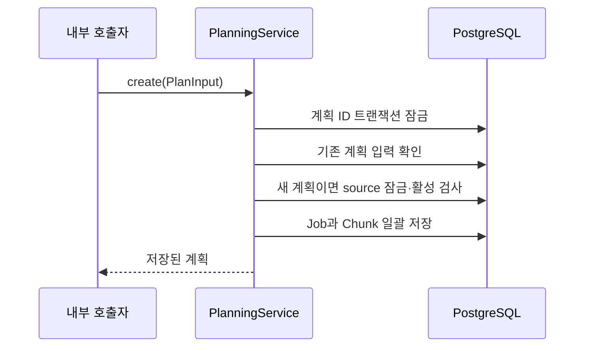

# Plan: SPEC-004 청크 계획과 DB 저장 — backend

- spec: docs `docs/specs/SPEC-004-pipeline-job-planning/spec.md` (정책 수정 PR #36)
- 계약: 외부 계약 변경 없음

## 1. 요약

BigDecimal PTS 초로 청크를 계산한다. 내부 PlanningService가 Job과 Chunk를 단일 트랜잭션으로 저장하고, JdbcPlanRepository가 PostgreSQL에서 복원한다. 같은 계획 ID는 저장한 전체 입력을 비교해 재사용하고 다른 입력은 거절한다. 영상당 활성 Job은 최대 하나다.

명세 정책 PR #36은 머지됐다. ADR-0007의 새 팀 정책은 별도 팀원 Approve 없이 자체 검토·필수 검사 후 명세를 확정·머지하도록 정한다. 공통 정책 PR에서 SPEC-004 상태를 Approved로 정리한다. GitHub 승인 리뷰가 있었다고 기록하지 않는다.

## 2. 담당 요구사항

| 요구사항 | 담당 컴포넌트 | 검증 테스트 |
| --- | --- | --- |
| R-1, R-2, R-6 | PlanInput 기본 프로필 | ChunkPlannerTest.profile/local |
| R-3, R-4, R-5 | ChunkPlanner | ChunkPlannerTest.ranges/coverage |
| R-7 | PlanInput 검증 | ChunkPlannerTest.invalid |
| R-8, R-9, R-11 | PlanningService, JdbcPlanRepository | PlanningServiceTest.persists |
| R-10 | PlanningService 트랜잭션 | PlanningServiceTest.rollback |
| R-12 | 계획 ID 재사용 | retries/equivalentDecimals/terminal |
| R-13 | 입력 충돌 | rejectsChangedInput/concurrentConflict |
| R-14 | 활성 Job 검사 | active |
| R-15 | 종료 후 새 계획 | terminal |
| R-16 | 계획 ID 잠금 | concurrentSame |
| R-17 | source 잠금·부분 유일 인덱스 | concurrentDifferent/uniqueActiveJob |
| NFR-1, NFR-2 | 전체 테스트·의존성 | 계산·저장 테스트, 외부 AI·Kafka 의존성 없음 |

## 3. 원칙 점검

| 원칙 | 준수 | 비고 |
| --- | --- | --- |
| I 스펙 우선 | ☑ | 사용자와 확정·머지한 명세 사용. ADR-0007에 따라 Approved 메타데이터 정리 |
| II 계약 우선 | ☑ | 외부 API·이벤트 변경 없음 |
| III 테스트 우선 | ☑ | 계산 실패 확인 후 구현, 저장 없는 골격의 통합 테스트 실패 확인 후 저장 구현 |
| IV 서비스 자율성 | ☑ | pipeline_db만 사용. 타 서비스 import·FK 없음 |
| V 단순성 | ☑ | Spring BOM JDBC·Flyway 사용, 새 플랫폼 없음 |
| VI 관측 가능성 | ☑ | Actuator health·JSON 로그·기존 tracing convention |
| VII 보안 | ☑ | 내부 입력 검증·바인딩 SQL·환경변수 비밀값 |
| VIII 문서·주석 | ☑ | plan·tasks·README 함께 갱신 |
| IX GitOps | ☑ | AWS·클러스터 변경 없음 |

## 4. 기술 설계

### 변경 대상

| 경로 | 변경 |
| --- | --- |
| settings.gradle.kts | 기존 설계 서비스 pipeline-service 모듈 등록 |
| services/pipeline-service | 계산 domain, 내부 유스케이스, JDBC 저장, Flyway, 테스트 |
| README.md, .env.example | 단독 실행 안내 |
| specs/SPEC-004-pipeline-job-planning | 계획·태스크 |

### 데이터 모델

`V202611030900__create_job_plans.sql`로 jobs와 chunks를 생성한다. PK는 BIGINT IDENTITY, created_at/updated_at은 TIMESTAMPTZ다. jobs는 plan_id UUID unique, source_id UUID, duration NUMERIC, profile VARCHAR(100), chunk_length/overlap NUMERIC, status를 저장한다. chunks는 Job FK, 순번, 소유·확장 구간 NUMERIC을 저장하고 (job_id, ordinal)은 unique다. source_id에 활성 상태(PLANNED/RUNNING/ANALYZED) 부분 유일 인덱스를 둔다.

시간은 반올림 없는 BigDecimal 초다. stripTrailingZeros로 동등한 소수 입력을 정규화한다. 전체 입력 비교에는 source·길이·프로필 이름·청크 길이·겹침을 사용한다. PLANNED 상태로 생성하며 실행·종료 전이는 구현하지 않는다.

### API / 이벤트

업무 API·Kafka·Outbox 없음. 외부 ID 직렬화 형식·벡터 차원을 확정하지 않는다. HTTP 서버는 Actuator만 제공한다.

### 상호작용

계획 잠금 후 source 잠금을 획득한다. `pg_advisory_xact_lock(namespace, hashtext(UUID))`를 사용하며 계획/영상 namespace는 1/2로 나눈다. 해시 충돌은 불필요한 직렬화만 유발한다. 예외 시 트랜잭션 전체를 롤백한다. DB 유일 제약은 잠금을 우회한 쓰기도 방어한다.

## 5. 대안과 선택 이유

| 대안 | 장점 | 단점 | 선택 |
| --- | --- | --- | --- |
| 메모리 락 | 간단함 | 여러 Pod에서 보호 안 됨 | 제외 |
| JPA 엔티티 | 기존 서비스와 유사 | 계획은 불변이고 정렬·일괄 저장만 필요 | 제외 |
| JDBC + DB 잠금 | 트랜잭션·SQL 경계 명확 | PostgreSQL 의존 | 채택 |

서비스 책임은 기존 ADR-0005 범위이며 새 서비스 경계·외부 계약은 추가하지 않는다.

## 6. 테스트 전략

- 단위: 운영 600/7200 경계 전후, 로컬, 짧은 영상, 배수, 소수 잔여 구간, 잘못된 입력
- 통합: Testcontainers PostgreSQL, 별도 트랜잭션 재조회, 두 번째 청크 제약 실패 후 전체 롤백, 재시도·입력 충돌·동시 요청·종료 후 새 계획
- E2E / 계약: 외부 API가 없으므로 해당 없음. ArchUnit으로 서비스 경계 검증

## 7. 리스크와 롤백

- 계획이 매우 큰 경우 청크 목록을 메모리에 올리므로 향후 영상 길이·청크 수 상한 계약에 맞춘 제한이 필요하다. 이번에는 문서에 없는 상한을 임의로 확정하지 않는다.
- DB 잠금은 트랜잭션 종료까지 유지한다. 트랜잭션 안에서 외부 I/O를 하지 않는다.
- 실패하면 이전 이미지로 복귀한다. 신규 테이블은 보존하며 기존 마이그레이션을 수정하지 않는다.

## 8. 배포 고려사항

PIPELINE_DB_URL/USERNAME/PASSWORD를 레포 .env.example에 추가한다. local compose·ECR·GitOps 등록 및 서비스 배포 workflow는 운영 인프라 준비 후 별도 작업이다. 현재는 Testcontainers와 단독 실행만 지원한다. Flyway가 시작 시 신규 테이블을 만든다. 배포 완료가 아니므로 spec을 Done으로 표시하지 않는다.

## 후속 설계 경계 (2026-11-03)

이 문서는 SPEC-004 구현 당시의 소수 초·planId 저장 설계를 기록한다. 정규화 수신의 목표 설계는 [SPEC-008 plan](../SPEC-008-normalized-intake/plan.md)으로 분리한다. 새 연동은 정수 밀리초이며 eventId를 planId로 사용하지 않는다. normalizationId와 불변 분석 설정에 의한 Job 재사용을 추가하되 기존 입력 비교·source 활성 제한은 유지한다. 계획 생성에 요청 Outbox를 붙이지 않고 배정 시 실행·슬롯·Outbox를 함께 저장한다. 이 후속 설계가 현재 코드·기존 NUMERIC 값의 단위를 이미 바꾼 것은 아니다.
