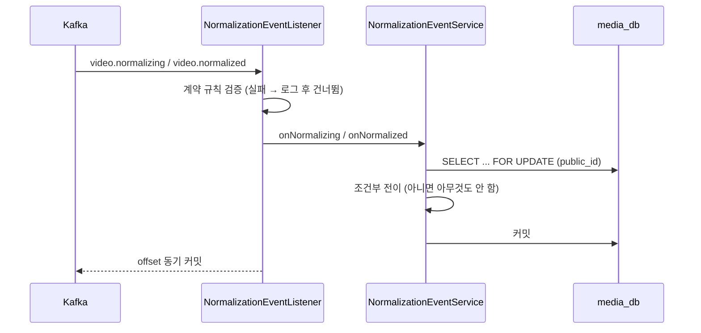

# Plan: SPEC-007 영상 정규화 — backend (media-service)

- spec: docs 레포 `docs/specs/SPEC-007-video-normalize/spec.md`
- 계약: docs 레포 `docs/contracts/events/video.normalizing.schema.json`, `video.normalized.v2.schema.json`, `docs/contracts/asyncapi/normalize.yaml`, `docs/contracts/openapi/media-service.yaml` 1.2.0
- 연동 규칙: docs ADR-0009(불변 정규화 결과, 정수 밀리초, 키 sourceId). normalize는 `video.normalized` v2만 발행한다.

## 1. 요약

media-service가 `video.normalizing`과 `video.normalized`(v2)를 받아 영상 상태를 `UPLOADED → NORMALIZING → READY·REJECTED`로 조건부 전이하고, 정규화 결과(normalizationId, 경로, 길이 ms, 예상 처리 시간, 거절 사유)를 저장한다. 영상 조회 응답에 `durationSec`, `estimatedProcessingSec`, `rejectReason`을 더한다. 삭제된 영상에 결과가 오면 저장소 정리를 다시 걸어 새로 생긴 정규화 파일까지 지운다.

## 2. 담당 요구사항

| 요구사항 | 담당 모듈 / 컴포넌트 | 검증 테스트 |
| --- | --- | --- |
| R-15 | `domain.Video`, `application.NormalizationEventService` | `VideoTest`, `NormalizationEventServiceTest` |
| R-16 | 같음 | `VideoTest`, `NormalizationEventServiceTest` |
| R-17 | 같음 | `VideoTest`, `NormalizationEventServiceTest` |
| R-18 | `domain.Video` | `VideoTest`, `NormalizationEventServiceTest` |
| R-19 | `domain.Video`, `NormalizationEventService` | `NormalizationEventServiceTest` |
| R-20 | `application.ProcessingEstimate` | `ProcessingEstimateTest` |
| R-21 | `api.VideoResponse` | `GetVideoApiTest`, `ListVideosApiTest`, `MediaContractTest` |
| NFR-6 | `NormalizationEventService`(행 잠금 + 조건부 전이) | `ConcurrentNormalizationTest` |
| (수신) | `api.NormalizationEventListener`, `api.NormalizationEventParser`, `config.NormalizationKafkaConfig` | `NormalizationEventParserTest`, `NormalizationKafkaTest` |

R-1~R-14, R-22, R-23, NFR-1~NFR-5는 ai(normalize) 담당이다.

## 3. 원칙 점검

| 원칙 | 준수 | 비고 |
| --- | --- | --- |
| I 스펙 우선 — spec이 Approved 상태인가 | ☑ | docs#48, docs#40 보완 |
| II 계약 우선 — 계약 변경이 먼저 머지됐는가 | ☑ | docs#49, docs#40 |
| III 테스트 우선 — 모든 R-*에 테스트가 매핑되고, 태스크가 요구사항 단위 TDD 사이클로 나뉘었는가 | ☑ | |
| IV 서비스 자율성 — 다른 서비스 DB나 코드에 직접 의존하지 않는가 | ☑ | 이벤트로만 받음 |
| V 단순성 — 새 의존성이나 추상화가 정당한가 | ☑ | spring-kafka는 common-messaging에 이미 있음. 수신 기록 테이블 없이 행 잠금 + 조건부 전이로 중복을 흡수 |
| VI 관측 가능성 — 로그, 추적, health를 갖췄는가 | ☑ | listener observation으로 traceparent 이어 감, 건너뛴 메시지는 eventId·offset 로그 |
| VII 보안 — 입력 검증, 인가, 비밀값 처리를 했는가 | ☑ | 메시지를 계약 규칙으로 검증, 경로는 그 영상의 `sources/<id>/` 아래만 받음 |
| VIII 문서·주석 — spec·계약·plan과 구현이 일치하고, 주석이 왜를 설명하는가 | ☑ | |
| IX GitOps — AWS 변경은 infra, 클러스터 변경은 gitops 레포를 거치는가 | ☑ | 해당 없음 |

## 4. 기술 설계

### 변경 대상

| 경로 | 변경 |
| --- | --- |
| `db/migration/V202611031500__add_video_normalization.sql` | `videos`에 정규화 결과 컬럼 추가 |
| `domain/Video.java` | `startNormalizing`, `completeNormalization`, `rejectNormalization`, 삭제 영상 정리 재요청 |
| `domain/NormalizationResult.java`, `domain/RejectReason.java` | 값 객체·거절 사유 |
| `application/NormalizationEventService.java` | 행 잠금 후 조건부 전이 |
| `application/ProcessingEstimate.java` | 예상 처리 시간 = ⌈길이(ms) × 계수 / 1000⌉ |
| `api/NormalizationEventParser.java` | JSON → 메시지 record, 계약 규칙 검증(`InvalidEventException`) |
| `api/NormalizationEventListener.java` | `@KafkaListener` 두 토픽 |
| `config/NormalizationKafkaConfig.java` | 수동 동기 커밋, 동시성 1, 잘못된 메시지는 로그 후 건너뜀, 일시 오류는 지수 백오프로 계속 재시도 |
| `api/VideoResponse.java` | `durationSec`, `estimatedProcessingSec`, `rejectReason` |

### 데이터 모델

`V202611031500__add_video_normalization.sql` (추가만, 기존 행은 NULL)

| 컬럼 | 타입 | 내용 |
| --- | --- | --- |
| `normalization_id` | UUID | 반영한 정규화 결과 ID |
| `normalization_version` | VARCHAR(100) | 정규화 방식 버전 |
| `normalized_key`, `hls_playlist_key` | VARCHAR(300) | 정규화 사본·HLS 재생 목록 키(다음 재생 spec에서 씀) |
| `duration_ms` | BIGINT | 정규화 사본 길이(정수 밀리초) |
| `estimated_processing_sec` | INTEGER | 예상 처리 시간(초) |
| `reject_reason` | VARCHAR(30) | 거절 사유 |
| `normalized_at` | TIMESTAMPTZ | READY·REJECTED로 바뀐 시각 |

### API / 이벤트

- 소비: `video.normalizing`(v1), `video.normalized`(v2), 그룹 `media-service`, 키 sourceId
- 응답: `getVideo`, `listVideos`의 `VideoResponse` 필드 추가(계약 1.2.0)

### 상호작용

전이 규칙

| 받은 이벤트 | 현재 상태 | 결과 |
| --- | --- | --- |
| `video.normalizing` | `UPLOADED` | `NORMALIZING` (R-15) |
| `video.normalized` READY | `UPLOADED`·`NORMALIZING` | `READY` + 결과 저장 (R-16) |
| `video.normalized` REJECTED | `UPLOADED`·`NORMALIZING` | `REJECTED` + 사유 (R-17) |
| `video.normalized` | `DELETED` | 저장소 정리 재요청(`storage_cleaned_at` NULL) (R-19) |
| 그 밖 | — | 변경 없음 (R-18) |
| 영상 없음 | — | 로그 후 건너뜀 |

## 5. 대안과 선택 이유

| 대안 | 장점 | 단점 | 선택 |
| --- | --- | --- | --- |
| 행 잠금 + 조건부 전이 | 기존 완료 처리와 같은 방식, 테이블 추가 없음 | 같은 영상 이벤트가 몰리면 잠금 대기 | ✅ |
| 처리한 eventId 기록 테이블 | 중복을 명시적으로 기록 | 테이블·정리 작업 추가. 전이가 이미 멱등이라 이득이 적음 | |
| 잘못된 메시지에서 파티션 정지(pipeline 방식) | 데이터 손실 없음 | 한 건 때문에 다른 영상 상태가 갱신되지 않음 | |
| 잘못된 메시지는 로그 후 건너뜀 | 다른 영상은 계속 처리 | 해당 영상은 수동 확인 필요 | ✅ |
| 삭제 영상 결과를 정리 작업에 다시 맡김 | 기존 정리 경로·재시도 재사용 | 다음 주기(1분)까지 파일이 남음 | ✅ |

## 6. 테스트 전략

- 단위: `VideoTest`(전이 규칙), `ProcessingEstimateTest`, `NormalizationEventParserTest`(계약 예시 통과, 규칙 위반 거절)
- 통합(Testcontainers PostgreSQL): `NormalizationEventServiceTest`, `ConcurrentNormalizationTest`
- Kafka 통합: `NormalizationKafkaTest` — 실제 토픽에 발행 → 상태 변경, 잘못된 메시지 뒤 메시지도 처리
- 계약: `MediaContractTest`(응답 필드), 이벤트 예시는 docs 원본에서 읽음

## 7. 리스크와 롤백

- 리스크: normalize가 늦게 배포되면 영상이 `UPLOADED`에 머문다 → 정상이다(대기).
- 리스크: 계약과 다른 메시지를 건너뛰면 그 영상은 상태가 바뀌지 않는다 → 로그에 eventId·sourceId·offset을 남겨 다시 발행으로 해결한다.
- 롤백: 마이그레이션은 컬럼 추가뿐이라 이전 버전이 그대로 동작한다.

## 8. 배포 고려사항

- 설정: `vlm.media.normalization.estimate-factor`(기본 1.0, 실측 전 임시값), `vlm.media.normalization.consumer-enabled`(기본 true), `spring.kafka.consumer.group-id`는 리스너에서 `media-service`로 고정
- 토픽 `video.normalizing`, `video.normalized`가 있어야 한다(로컬은 docs `local/` kafka-init).
- 배포 순서: 계약 → media-service → normalize. 먼저 배포해도 이벤트가 없을 뿐이다.
