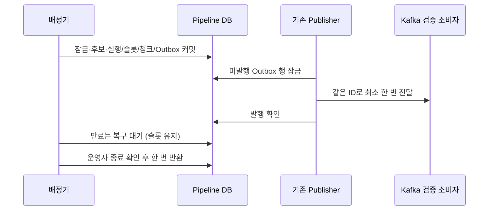

# Plan: SPEC-010 공정 배정·슬롯·요청 Outbox — backend

- spec: docs 레포 `docs/specs/SPEC-010-chunk-dispatch/spec.md`
- 계약: `docs/contracts/events/chunk.requested.schema.json`, `asyncapi/pipeline-service.yaml`
- 선행: docs #55·#56 머지, ADR-0009. backend #39 추적

## 1. 요약

기존 SPEC-008의 연결 계획과 SPEC-004 청크를 재사용한다. 배정 한 건마다 DB advisory transaction lock(namespace 5, key 0)으로 상한·공정성·회수 결정을 직렬화한다. Kafka I/O는 이 트랜잭션에 넣지 않고 기존 common-messaging OutboxRecorder/Publisher를 사용한다. 자동 배정/발행은 opt-in이며 운영 활성화하지 않는다. 만료는 복구 대기이고 종료 확인 명령만 슬롯을 반환한다.

## 2. 담당 요구사항

| 요구사항 | 담당 모듈 / 컴포넌트 | 검증 테스트 |
| --- | --- | --- |
| R-1 | 후보 조회 | DispatchServiceTest: 미연결·비활성 제외·정수 ms |
| R-2 | 슬롯 count·구성 일치 | DispatchServiceTest: 사용자/영상/전체 및 설정 충돌 |
| R-3 | DB 전역 잠금·부분 유일 제약 | DispatchServiceTest: 다중 인스턴스·동시 복구 |
| R-4 | 영속 마지막 배정 sequence | DispatchServiceTest: 다중 사용자·다중 영상·재시작 |
| R-5 | DispatchService 트랜잭션 | DispatchServiceTest: 정상 상태·슬롯·Outbox |
| R-6 | 요청 DTO·공통 Recorder | DispatchKafkaTest: schema/key/trace/profile/range |
| R-7 | 불변 Outbox | DispatchKafkaTest: 같은 payload/event/execution/request |
| R-8 | 모든 저장 경계 | DispatchServiceTest: 실패 주입·재시도 |
| R-9 | 기존 Publisher | DispatchKafkaTest: send 실패·전송 후 커밋 실패·재시작 |
| R-10 | 만료 표시 | DispatchServiceTest: 기한 경계·반환 없음 |
| R-11 | recovery 서비스·CLI | DispatchServiceTest/DispatchRecoveryCommandTest: 반환·중복·롤백 |
| R-12 | 확인 불변성 | DispatchServiceTest: 잘못된 ID/증거·동시 요청 |
| R-13 | 조건부 자동 작업 | DispatchServiceTest: 기본 비활성·설정 검증 |
| NFR-1~3 | 실제 DB/Kafka·메트릭 | 위 통합 테스트·복구 gauge |

## 3. 원칙 점검

| 원칙 | 준수 | 비고 |
| --- | --- | --- |
| I 스펙 우선 | 예 | Approved 명세 docs #55·#56 선행 머지 |
| II 계약 우선 | 예 | 신규 backend 요청 계약 선행 머지, 기존 v1/v2 수신 불변 |
| III 테스트 우선 | 예 | 아래 tasks의 각 사이클에 Red/Green 기록 |
| IV 서비스 자율성 | 예 | pipeline DB만 변경. worker 직접 DB 접근 없음 |
| V 단순성 | 예 | common-messaging 재사용, 신규 외부 라이브러리 없음. 전역 잠금은 작은 배정 TX만 |
| VI 관측 가능성 | 예 | 기존 health/JSON로그, traceparent 원장 전파, 복구 gauge |
| VII 보안 | 예 | 업무 API 추가 없음. 운영 CLI에 확인 증거 필수, 비밀값 로그 없음 |
| VIII 문서·주석 | 예 | spec/계약 선행, 구현과 plan/tasks 함께 |
| IX GitOps | 예 | 배포·AWS 변경 없음 |

## 4. 기술 설계

### 변경 대상

| 경로 | 변경 |
| --- | --- |
| services/pipeline-service/.../application | DispatchService·DispatchRecoveryService 트랜잭션 |
| services/pipeline-service/.../domain | DispatchRepository·후보/요청 불변 값 |
| services/pipeline-service/.../infra/persistence | JDBC 후보/슬롯/시도/공정 순서 |
| services/pipeline-service/.../config | opt-in 주기, 구성, 복구 CLI, 메트릭 |
| libs/common-messaging | 기존 구현 그대로 재사용 |

### 데이터 모델

`V202611031600__add_chunk_dispatch.sql` additive migration. chunks에 외부 chunk_id UUID(DEFAULT gen_random_uuid(), UNIQUE), status PENDING 기본값을 추가한다. 기존 PK·구간·순번 유지. 기존 수신/계획 데이터 변환 없음.

- dispatch_states: singleton(id=1) 및 전역 sequence·활성 구성. 슬롯이 없을 때만 구성 변경 가능
- dispatch_users: owner_id unique, last_sequence (재시작 후에도 유지)
- chunk_executions: execution_id UUID unique, chunk FK, event_id UUID unique, status DISPATCHED/RECOVERY_REQUIRED/STOPPED, start_before, confirmation_id unique, evidence. 청크별 활성 실행 부분 unique
- execution_slots: execution_id unique FK, owner_id/source_id, released_at nullable. 미반환 슬롯을 세 단계 상한에 모두 포함
- outbox_events: 기존 media/common-messaging와 동일 테이블 구조와 pending 인덱스

모든 테이블 BIGINT IDENTITY PK와 created_at/updated_at. 반환/만료/배정은 같은 advisory lock을 쓴다. 후보는 chunks와 jobs 행도 잠가 외부 상태 갱신과 직렬화한다. DB는 최종 유일 제약으로도 보호한다.

활성 구성은 사용자/영상/전체 상한 및 시작 기한이다. 상한이 다른 서버를 조용히 허용하지 않는다. 배정시 슬롯이 남아 있고 구성 불일치면 오류, 없으면 구성 전환 가능. 시각은 DB clock_timestamp() 기준(잠금 대기 뒤 실제 DB 시각)이며 JVM 시계/테스트 가짜 시계로 바꾸지 않는다.

후보 정렬은 COALESCE(사용자 last_sequence,0), owner_id, job.created_at, job.id, chunk.ordinal. 배정마다 sequence 증가. 청크 request는 job.plan_id, 새 chunk UUID, execution UUID 및 별도 event UUID를 사용한다. requestId=executionId. processingProfile은 analysis_settings JSON의 저장된 정의를 복원한다. 정확한 ms는 BigDecimal.movePointRight(3).longValueExact(). 정규화 key 검증은 SPEC-008 결과를 재사용한다.

### API / 이벤트

업무 HTTP API 없음. chunk.requested 신규 v1만 발행. OutboxRecorder.record를 application 트랜잭션에서 호출하고 원 수신 trace_parent를 같은 Outbox 행에 보존한다. 새 스케줄 span으로 원인 trace를 바꾸지 않는다. Publisher의 스케줄은 dispatch 플래그 기본 false를 따른다. 기존 Publisher는 배정·회수 정책을 알지 않는다.

종료 확인은 내부 DispatchRecoveryService.confirmStopped와 opt-in 일회성 CLI로 제공한다. CLI는 비웹 Spring 컨텍스트에서 execution UUID·confirmation UUID·증거 참조를 검증 후 실행하고 종료한다. evidence는 1~500자이며 비밀값을 넣지 않는다. 중복 확인은 기존 ID·증거가 같을 때만 성공한다. 슬롯 반환·STOPPED·FAILED는 하나의 트랜잭션이다. 기한 이전 반환은 거부한다. 다른 confirmation 재사용도 거부한다. 미확인·지연 요청은 startBefore 후 소비자가 신규 시작하지 않는 계약을 전제로 한다. 자동 결과 성공 반영이나 자동 재실행은 없다.

### 상호작용

## 5. 대안과 선택 이유

| 대안 | 장점 | 단점 | 선택 |
| --- | --- | --- | --- |
| 전역 DB advisory lock | 다중 상한과 순환 원자성이 단순 | 배정 TPS 제한 | 선택. 짧은 TX, Kafka 분리 |
| 분산 카운터/Redis | 높은 처리량 | DB 원자성·복구 복잡 | 제외 |
| 만료 즉시 반환 | 자동 진행 | 실제 AI가 계속 실행될 수 있어 상한 초과 | 제외 |
| 종료 증거 후 반환 | 안전하게 모호한 전달 처리 | 실제 워커 전에는 수동 개입 필요 | 선택. runtime opt-in |

새 서비스·통신 구조 교체·기존 계약 파괴가 없어 ADR-0009 내 구현 상세로 둔다.

## 6. 테스트 전략

- 단위: 운영 구성·UUID/증거 검증, DTO 계약
- 통합: 실제 PostgreSQL, 다중 스레드와 독립 서비스 인스턴스, 각 DB 저장 지점 실패 후 전체 롤백
- E2E / 계약: 실제 Kafka, 기존 Publisher, 전송 실패·커밋 실패 후 재전달. 검증 소비자가 실행별 입력을 비교해 논리 한 번 처리
- 기존 SPEC-008의 Outbox 테이블 부재 단언은 '수신 후 Outbox 0건'으로 바꾼다. 테이블 추가로 구현 전제를 갱신하며 기능 요구를 약화하지 않는다

## 7. 리스크와 롤백

- 리스크: worker 완료 연동이 없어 실제 성공 처리 흐름은 미완료. 만료 슬롯은 운영 확인까지 상한을 차지한다. recovery gauge로 드러내고 CLI로 회수 가능
- 롤백 방법: 배정·발행 플래그 off, 실행 종료 확인 후 슬롯 회수. 발행 이력/Outbox/실행을 삭제하지 않는다. additive migration은 보존

## 8. 배포 고려사항

PIPELINE_DISPATCH_ENABLED 기본 false, 사용자2/영상1/전체4, start-window-ms=300000, interval-ms=1000, batch-size=100. 잘못된 양수/상한 관계를 시작 시 거부. backend .env.example에 추가. local compose에 pipeline 자체가 없어 root local 예제에는 미연결임을 설명한다. gitops 배포는 변경하지 않음.

착수 시 ai main은 normalize가 없었으나 작업 중 ai #12가 머지됐다. 최종 확인 `40356fe`에는 normalize v2가 있고 docs #57로 compose 생산자가 추가됐다. Pipeline은 compose에 없고 intake는 기본 disabled다. producer는 재처리시 같은 eventId에 occurredAt을 새로 생성하여 SPEC-008 EVENT_CONFLICT와 충돌한다(회귀 테스트 확인). 최초 결과 이벤트의 불변 재사용이 후속 연결의 선행 조건이다. 테스트 입력은 producer 연결로 보고하지 않는다. 운영 플래그와 Kafka offset은 변경하지 않는다.

### 구현 검증 결과

Pipeline 134개, 전체 backend 468개 테스트가 통과했다(실패·skip 0). 기존 Outbox 코드는 수정하지 않고 실제 Kafka에서 재발행을 검증했다. 애플리케이션 JAR에 요청 스키마와 복구 명령이 포함된다. 패키징 CLI를 별도 PostgreSQL로 실행해 강제 비활성화·실제 슬롯 반환·충돌 거부를 확인했다. opt-in 자동 주기에서 수동 dispatch 호출 없이 발행·만료 표시·종료 확인 뒤 다음 청크 배정까지 실제 Kafka로 검증했다. 운영 배포와 producer/worker 연결은 수행하지 않았다.

계획 대비 구체화: 복구 CLI는 별도 main entrypoint(`DispatchRecoveryCommand`)이며 실행 인자 3개만 받는다. 컨텍스트 시작 시 명령행 설정으로 intake/dispatch/outbox/web을 강제로 끈다. 별도 enabled 플래그나 HTTP 운영 API는 추가하지 않는다.
