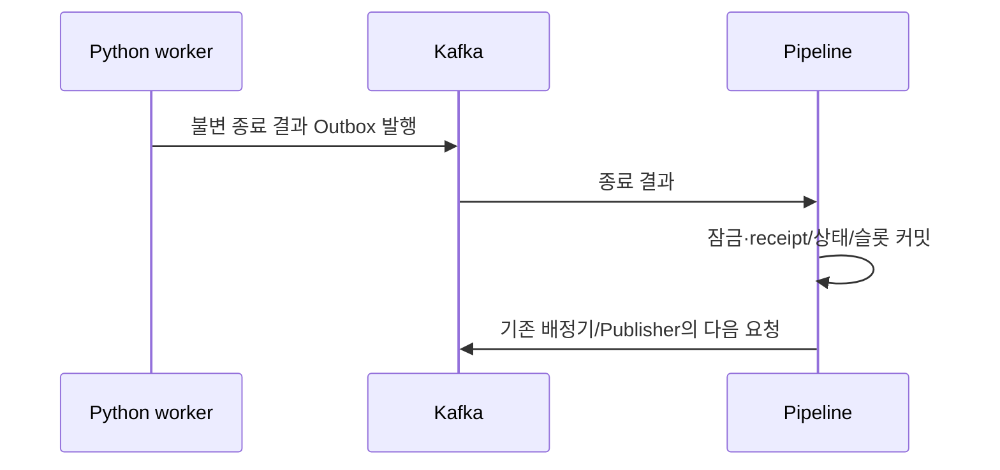

# Plan: SPEC-014 실행 종료 결과와 슬롯 반환 — backend

- 명세: docs `docs/specs/SPEC-014-execution-results/spec.md` (docs #87 선행 머지)
- 계약: `service-contracts/events/chunk.execution.finished.schema.json`, 묶음 2.5.1

## 1. 요약

기존 Pipeline DB·배정/복구 전역 advisory lock(5,0)·Publisher를 재사용한다. 결과 수신의 receipt/실행 종료/청크/슬롯은 같은 트랜잭션이다. 소비는 opt-in, DB 커밋 이후 offset을 처리한다. Python 워커 실제 이미지와 Kafka/worker DB/객체 저장소를 연결한 통합 테스트를 둔다.

## 2. 담당 요구사항

| 요구사항 | 대상 | 검증 |
| --- | --- | --- |
| R-9 | 결과 반영 | ExecutionResultTest.normal |
| R-10 | 중복·동시 | ExecutionResultTest.duplicates/concurrent |
| R-11 | 늦은 결과 | ExecutionResultTest.stale |
| R-12 | ID·결과 충돌 | ExecutionResultTest.conflicts |
| R-13 | CLI 경쟁 | ExecutionResultTest.cliRace |
| R-14 | 원자성·offset | ExecutionResultTest.rollback, 실행 Kafka 통합 |
| R-15, NFR-1~3 | 실제 Python 워커·Kafka·다음 배정 | ChunkLifecycleKafkaTest |

## 3. 원칙 점검

| 원칙 | 준수 | 근거 |
| --- | --- | --- |
| I 스펙 우선 | 예 | docs #87 선행 머지 |
| II 계약 우선 | 예 | 계약 릴리스 2.5.1 고정 |
| III 테스트 우선 | 예 | 정상 반환 Red 뒤 구현, 경계·경쟁·롤백 확장 |
| IV 서비스 자율성 | 예 | worker는 자체 DB만 사용. Pipeline DB 직접 쓰기 없음 |
| V 단순성 | 예 | 기존 JDBC/Kafka/Outbox 재사용 |
| VI 관측 | 예 | source 키·traceparent·기존 health·구조화 로그 |
| VII 보안 | 예 | 스키마·식별/경로 검증, 비밀값 없음 |
| VIII 문서 | 예 | plan/tasks와 구현 함께 |
| IX GitOps | 예 | 배포/활성화/offset 변경 없음 |

## 4. 기술 설계

### 변경 대상

application/ExecutionResultService, domain/ExecutionFinished·ResultRepository, infra/persistence/JdbcResultRepository, 결과 parser/listener/config. 기존 DispatchRepository.lock과 CLI 경계를 재사용한다.

### 데이터 모델

V202611050930__add_execution_results.sql: chunks에 PROCESSED, 실행에 SUCCEEDED/FAILED를 허용하는 expand 변경. 실행 result_payload(JSONB) 의미 결과를 추가한다. execution_result_receipts는 BIGINT IDENTITY·event_id unique·execution_id FK·payload·처리결정·created_at/updated_at을 가진다. 기존 마이그레이션은 수정하지 않는다.

### API / 이벤트

새 업무 HTTP API 없음. chunk.execution.finished를 별도 opt-in 그룹으로 소비한다. 원 요청의 식별 전부와 결과 경로를 검사한다. eventId는 전체 payload, 다른 eventId의 같은 실행은 outcome/resultKey/errorCode 의미를 비교한다. terminal 상태/더 새 실행은 규칙대로 DUPLICATE 또는 IGNORED다. 알 수 없는 실행·입력 충돌은 성공 offset을 커밋하지 않는다.

### 상호작용

CLI가 먼저면 STOPPED 유지·늦은 결과 IGNORED, 결과가 먼저면 CLI no-op. timeout은 결과가 아니며 RECOVERY_REQUIRED 슬롯을 유지한다. worker 정상 성공은 PROCESSED일 뿐 downstream 적재/Job 완료가 아니다.

## 5. 대안과 선택 이유

기존 chunk.manifest를 종료로 재해석하면 downstream 의미가 충돌하므로 별도 종료 계약을 사용한다. 분산 카운터를 추가하지 않고 기존 DB 잠금을 재사용한다. 새 서비스나 기존 통신 교체가 없어 ADR-0009 구현 상세로 둔다.

## 6. 테스트 전략

실제 PostgreSQL의 정상/중복/충돌/동시/CLI 경쟁/이전 시도/실패 지점 롤백. 실제 Kafka와 고정 Python worker 이미지에서 요청 소비→실제 추출·검증 추론→결과→반환→다음 배정을 검증한다. 모델 API는 호출하지 않는다.

## 7. 리스크와 롤백

결과 소비 플래그를 끄면 기존 수동 복구가 유지된다. additive 스키마와 기록을 삭제하지 않는다. worker 불명 RUNNING은 임의 재실행/자동 반환하지 않으며 운영 확인이 필요하다.

## 8. 배포 고려사항

PIPELINE_RESULTS_ENABLED=false 기본값, 새 결과 그룹은 별도 설정. worker/계약 호환을 확인한 뒤 운영 변경은 별도 GitOps로 진행한다. 기존 offset을 변경하지 않는다.

## 검증 기록

- Red: 결과 service 미구현 APPLIED 기대/IGNORED 실제를 확인한 뒤 구현했다.
- Green: 전체 backend 506개/Pipeline158개, 실패·skip0. 기존 IDE DEBUG만 제거하여 필수 spotlessCheck/build를 통과했다.
- 실제 normalize/worker runtime 이미지·Kafka·서로 다른 DB·인증 S3에서 v2 재전달 payload 동일성, 실영상 추출/검증 추론, 성공/실패 종료, 슬롯 반환 후 다음 배정, 결과 DB 실패 중 offset/슬롯 유지와 해소 뒤 재수신을 검증했다.
- 결과 중복/동시/이전 시도/CLI 경쟁/각 저장 경계 롤백/잘못된 식별·결과 경로·producedAt을 검증했다.
- 실제 연결에서 producedAt 덮어쓰기 실패를 발견해 docs #89를 선행 명확화했다. 같은 eventId 전체 비교는 유지하며 새 이벤트 정규화 메타데이터에서만 producedAt을 제외한다. 기존 저장 메타데이터의 producedAt도 비교 경계에서 제외하고 기록 자체를 덮어쓰지 않는다.
- backend/worker의 운영 활성화·기존 offset 변경·실제 AI 호출은 수행하지 않았다.

CI의 실제 worker source는 ai #34 머지 커밋 `5408a90b67f15d3af187d9083709c2c6820db141`로 고정한다. 애플리케이션 의존성은 아니며 테스트 runtime 이미지 빌드에만 사용한다. 복구 CLI 패키징 smoke에서 results enabled=true 환경도 강제로 비활성화함을 확인했다.
