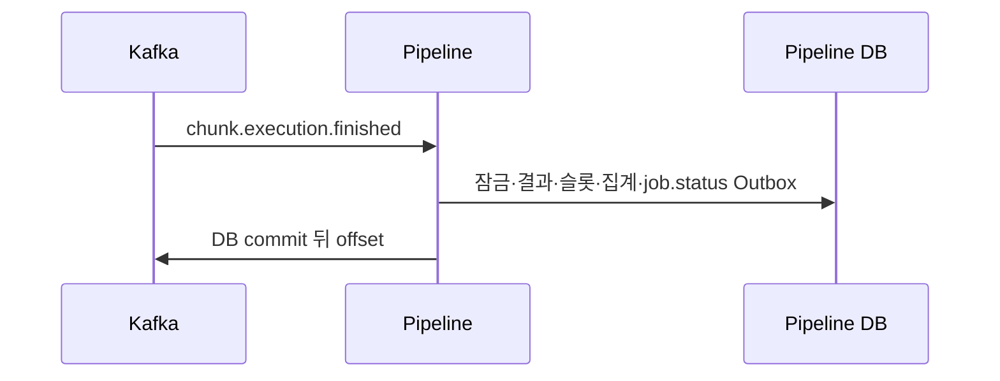

# Plan: SPEC-015 Job 실행 집계 — backend

- spec: docs `docs/specs/SPEC-015-job-execution-status/spec.md` (docs #91 머지)
- 계약: service-contracts 2.6.0, pipeline-service OpenAPI·job.status·기존 종료/요청

## 1. 요약

기존 실행·슬롯·Outbox·전역 advisory lock(5,0)을 재사용한다. Job 분석 status는 보존하고 별도 JSONB 스냅샷과 순번을 내구 저장한다. 결과 수신·배정·복구·정규화 계획 연결 직후 같은 트랜잭션에서 집계한다. 주기 점검은 별도 비활성 기본값으로 둔다.

## 2. 담당 요구사항

| 요구사항 | 담당 모듈 | 검증 |
| --- | --- | --- |
| R-1~R-4 R-11 R-12 | JobExecutionService/Repository | JobExecutionTest |
| R-5 R-6 | 불변 Job 재시도 정책·기존 배정기 | JobExecutionTest |
| R-7 R-8 | 기존 결과/CLI 트랜잭션·Outbox | JobExecutionTest·ExecutionResultTest |
| R-9 NFR-3 | bounded 점검 스케줄 | JobExecutionTest |
| R-10 | JobExecutionController/UserHeaders | JobExecutionTest |
| NFR-1 NFR-2 | 기존 실제 워커 통합 확장 | JobExecutionTest·ChunkLifecycleKafkaTest |

## 3. 원칙 점검

| 원칙 | 준수 | 비고 |
| --- | --- | --- |
| I 스펙 우선 | 예 | docs #91 머지 |
| II 계약 우선 | 예 | 2.6.0 릴리스 고정 |
| III 테스트 우선 | 예 | 아래 tasks별 Red→Green |
| IV 자율성 | 예 | 자기 DB만 조회, 워커는 기존 Kafka |
| V 단순성 | 예 | 새 라이브러리 없음 |
| VI 관측 | 예 | 기존 tracing·health, 점검 실패 로그 |
| VII 보안 | 예 | UserHeaders와 owner DB 조건 |
| VIII 문서 | 예 | README·명세·tasks 동기화 |
| IX GitOps | 예 | 운영 설정·배포 변경 없음 |

## 4. 기술 설계

### 변경 대상

| 경로 | 변경 |
| --- | --- |
| domain/JobExecutionRepository | 집계·복구·조회 인터페이스 |
| application/JobExecutionService | 트랜잭션·잠금·Outbox 경계 |
| infra/persistence/JdbcJobExecutionRepository | 최신 실행·실패 이력·정책·스냅샷 비교 |
| api/JobExecutionController | getJobExecution |
| config/JobExecutionConfiguration | 비활성 기본값 bounded 점검 |

### 데이터 모델

V202611051500__add_job_execution_summaries.sql로 jobs에 max_attempts/retryable_error_codes/retry_delay_ms 기본값 추가(과거 1회 정책). 새 Job은 검증된 운영 설정을 저장한다. chunks에 retry_at와 RETRY_PENDING 제약 확장. job_execution_summaries는 identity PK, job_id 유일 FK, sequence, snapshot JSONB, checked_at, created_at/updated_at. 순번은 jobs.execution_sequence에도 보존해 projection 누락 복구가 순번을 되돌리지 않게 한다. 기존 마이그레이션 수정 없음. 사용자 요청의 집계 저장·재시도 범위에 해당한다.

### API / 이벤트

getJobExecution: GET /api/v1/jobs/{jobId}/execution. gateway의 기존 /jobs/** 경유. 타인·미존재·owner 미연결은 404. 외부 입력·오류는 common-web 재사용. docs #92에 따라 소유자 확인 후 같은 잠금으로 원장·집계를 보정하므로 기존 owner 연결 Job도 조회 가능하다.

job.status는 변경된 전체 스냅샷과 sequence, 공통 envelope를 갖고 기존 Publisher로 보낸다. snapshot의 비교 대상은 분석 status·execution·issues·failures이며 sequence와 발행 시각은 비교에서 제외한다. 입력 payload·기존 종료 수신 비교는 변경하지 않는다.

### 상호작용

## 5. 대안과 선택 이유

| 대안 | 장점 | 단점 | 선택 |
| --- | --- | --- | --- |
| 기존 jobs.status를 COMPLETED로 변경 | 필드 감소 | 적재 완료 의미 위반 | 아니오 |
| 실행 집계 별도 저장 | 생명주기 보존·복구 가능 | 스냅샷 관리 | 예 |

기존 분석 생명주기를 교체하거나 새 서비스·기술을 추가하지 않는다.

## 6. 테스트 전략

- PostgreSQL 실제 결과 수신·CLI·재시도·점검·실패 주입·동시 결과
- MockMvc 실제 DB 소유자·누락/잘못된 헤더·404·계약 응답
- 실제 Python worker·Kafka·S3 통합에 집계와 job.status 소비 검증 추가

## 7. 리스크와 롤백

전역 잠금은 기존 상한 직렬화를 보존한다. 점검은 checked_at 순서 1~1000개 배치로 순환하며 실패 시 전부 롤백한다. 잘못된 재시도 설정은 시작 시 거절한다. 과거 owner 미연결은 추정하지 않는다. 다운그레이드는 재시도 대기 데이터가 있으면 구버전에서 처리하지 못하므로 점검/배정 정지와 데이터 확인 뒤 수행한다.

## 8. 배포 고려사항

점검 기본 비활성, 재시도 기본 1회/허용 코드 없음. 환경 예시만 갱신하고 운영 설정·offset은 변경하지 않는다. 분석 상태는 유지되므로 실행 종료만으로 새 활성 Job을 허용하지 않는다. 실제 AI·적재 이벤트는 후속이다.
