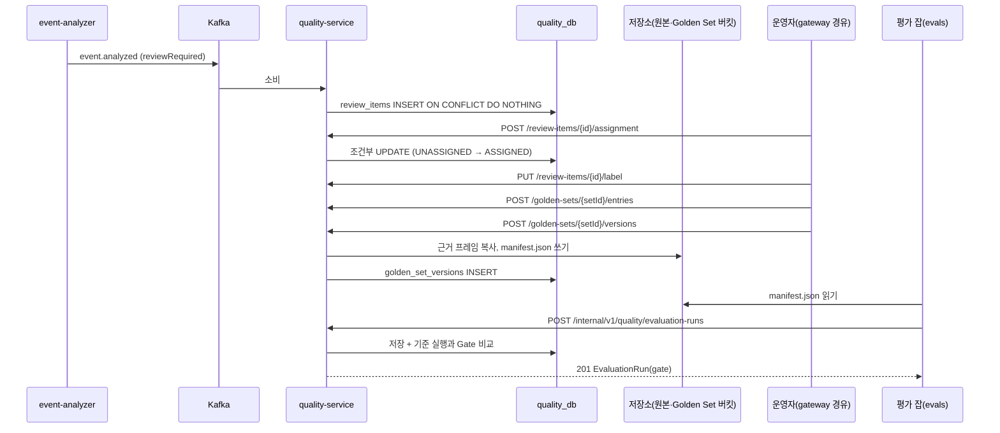

# Plan: SPEC-029 quality-service 검토 큐·Golden Set·평가 실행·처리 단계 리포트 — backend

- spec: docs 레포 `docs/specs/SPEC-029-quality-service/spec.md`
- 계약: docs 레포 `service-contracts/openapi/quality-service.yaml` 3.0.0, `quality/v1/golden-manifest.schema.json`, `events/{event.analyzed,stage.timing,video.deleted,_vlm-analysis,_envelope}.schema.json`, `stages/v1/{stage-timing,stages}.schema.json`, `taxonomy/v2/taxonomy.schema.json` (계약 묶음 5.0.0)
- ADR: ADR-0007, ADR-0008(배포 단위 quality-service), ADR-0010 ⑨·⑩, ADR-0011(Golden Set 확정 버전 보존)

- v5.1(계약 묶음 4.0.0, 2026-11-07, ADR-0016): `openapi/quality-service.yaml` 2.0.0은 검토 항목 `reason`을 `x-extensible-enum`으로 바꾸고 `budget_exceeded`·`call_cap_reached`·`model_unavailable`·`alert_dismissed`를 더했으며, 목록 필터 `reason`과 알림 지표 리포트 `GET /api/v1/quality/alert-reports`를 더했다. 소비 토픽에 `alert.raised`(`events/alert.raised.schema.json`)가 더해지고 `event.analyzed`에 `unverifiedReason`이 생겼다. R-27(사유별 재판정 큐)·R-28(긴급 알림 기록·지표)을 아래 설계 절대로 더한다. 잠금은 T001에서 4.1.0(`quality-service.yaml` 2.0.0)으로 올렸다. 4.1.0은 4.0.0 위에 경계 박스 범위·stitched 쌍·예측 빈 구간을 고친 묶음이고 이 서비스가 쓰는 계약은 바뀌지 않았다. 이후 SPEC-030 PR에서 잠금을 5.0.0(`quality-service.yaml` 3.0.0, ADR-0018)으로 올렸다. 3.0.0은 `GateResult.failures[].value`·`ReviewItem.analysis`에 null을 허용하고 `ReviewItem.startMs`·`endMs`를 int64로 바꿨다(12절).

## 1. 요약

- `services/quality-service` 모듈을 새로 만든다. catalog와 ADR-0008에 이미 있는 배포 단위라 새 서비스 결정은 아니다. 뼈대는 media-service와 같다(Spring Boot servlet, JPA + Flyway `quality_db`, `libs/common-web`·`common-core`, Testcontainers PostgreSQL·Kafka·SeaweedFS, ArchUnit 기능 구조).
- 기능 패키지는 `review`(검토 큐), `golden`(Golden Set), `evaluation`(평가 실행·CI Gate), `stage`(처리 단계 측정·리포트), `deletion`(삭제 전파)이다. Kafka 소비는 `event.analyzed`·`stage.timing`·`video.deleted` 3종이고 발행은 없다.
- 서버 API 인터페이스와 요청·응답 모델은 `openapi/quality-service.yaml`에서 openapi-generator Gradle 플러그인으로 빌드 때 생성한다(handoff 3절 "내부 호출 클라이언트는 생성", 이번 작업 지시). 컨트롤러는 생성된 인터페이스를 구현한다.
- 계약 잠금을 2.9.1에서 4.0.0으로 올리는 것이 구현 첫 태스크다. 4.0.0의 `quality-service.yaml`은 2.0.0이라 SPEC-035가 더한 `ReviewItem.evidenceFrameUrls`(근거 프레임 서명 주소)가 필수다. 이 서명 주소는 이 plan의 R-5 응답에서 함께 만든다.
- api-gateway에 `/api/v1/quality/**` 라우트 하나를 더한다.
- 새 외부 의존성: openapi-generator Gradle 플러그인(합의함, handoff 3절). 그 밖의 새 라이브러리는 없다. 백분위·집계는 PostgreSQL `percentile_cont`로 하고, 한 Pod만 도는 주기 작업은 PostgreSQL advisory lock으로 한다(ShedLock 같은 새 라이브러리를 들이지 않는다).
- DB 스키마: 새 서비스의 `quality_db` 테이블 8개(아래 "데이터 모델"). 새 서비스의 스키마라 기존 합의 범위다.

## 2. 담당 요구사항

경로 약어: `Q` = `services/quality-service/src`, `G` = `services/api-gateway/src`, `C` = `libs/common-core/src`, `A` = `Q/main/java/com/vlm/quality/alert`

| 요구사항 | 담당 모듈 / 컴포넌트 | 검증 테스트 |
| --- | --- | --- |
| R-1 | `review/infra/messaging/EventAnalyzedListener`, `review/application/ReviewIntakeService`, `C/.../id/NameBasedUuid` | `EventAnalyzedIntakeTest`, `NameBasedUuidTest` |
| R-2 | `review/domain/ReviewSampling`, `ReviewIntakeService` | `ReviewSamplingTest`, `EventAnalyzedIntakeTest` |
| R-3 | `ReviewItemRepository#insertIfAbsent`(`ON CONFLICT DO NOTHING`) | `EventAnalyzedIntakeTest` |
| R-4 | `config/OperatorRoleInterceptor` | `OperatorRoleTest` |
| R-5 | `review/api/ReviewItemController`, `review/application/ReviewQueryService`, `shared/infra/storage/EvidenceUrlSigner` | `ReviewQueueApiTest` |
| R-6 | `review/application/ReviewAssignmentService#assign`(조건부 UPDATE) | `ReviewAssignmentApiTest` |
| R-7 | `ReviewAssignmentService#release` | `ReviewAssignmentApiTest` |
| R-8 | `review/application/ReviewLabelService` | `ReviewLabelApiTest` |
| R-9 | `review/domain/ReviewLabelRules` | `ReviewLabelRulesTest`, `ReviewLabelApiTest` |
| R-10 | `review/application/StaleAssignmentJob`, `shared/infra/persistence/SingleRunLock` | `StaleAssignmentJobTest` |
| R-11 | `golden/api/GoldenSetController`, `golden/application/GoldenSetService` | `GoldenSetApiTest` |
| R-12 | `golden/application/GoldenDraftService#add`(→ `review/application/ReviewQueryService`) | `GoldenDraftApiTest` |
| R-13 | `GoldenDraftService#remove` | `GoldenDraftApiTest` |
| R-14 | `golden/application/GoldenFreezeService`, `golden/application/GoldenManifestWriter`, `shared/infra/storage/S3ObjectStorage` | `GoldenFreezeApiTest`(매니페스트를 계약 스키마로 검증) |
| R-15 | `GoldenFreezeService`(`golden_sets.freeze_started_at` 조건부 UPDATE) | `GoldenFreezeApiTest`, `ConcurrentFreezeTest` |
| R-16 | `deletion/infra/messaging/VideoDeletedListener`, `deletion/application/SourceDeletionService` | `VideoDeletedIntakeTest` |
| R-17 | `evaluation/api/InternalEvaluationRunController`, `evaluation/application/EvaluationRunService`, `config/InternalCallerFilter` | `SubmitEvaluationRunApiTest` |
| R-18 | `evaluation/domain/GateCalculator` | `GateCalculatorTest`, `SubmitEvaluationRunApiTest` |
| R-19 | `evaluation/application/BaselineService`(→ `golden/application/GoldenSetService#setBaseline`) | `BaselineApiTest` |
| R-20 | `evaluation/api/EvaluationRunController`, `EvaluationRunService#list·get` | `EvaluationRunQueryApiTest` |
| R-21 | `stage/infra/messaging/StageTimingListener`, `stage/application/StageTimingIngestService`, `stage/infra/persistence/JdbcStageTimingRepository` | `StageTimingIntakeTest` |
| R-22 | `stage/application/StageReportService#sourceReport` | `SourceStageReportApiTest` |
| R-23 | `stage/application/DailyStageAggregationJob` | `DailyStageAggregationTest` |
| R-24 | `stage/application/StageReportService#trend`, `stage/domain/TrendQuery` | `StageTrendApiTest` |
| R-25 | `stage/application/StageTimingPartitionJob` | `StageTimingPartitionTest` |
| R-26 | `G/main/resources/application.yml` 라우트 `quality-service` | `G/test/.../RoutingTest`, `QualityRoutingTest` |
| R-27 | `review/application/ReviewIntakeService`(`unverified` → 사유 `unverifiedReason`), `review/domain/ReviewReason`(계약 `x-extensible-enum` 목록), `ReviewQueryService#list`(`reason` 필터) | `EventAnalyzedIntakeTest`(사유 3종), `ReviewQueueApiTest`(필터), `QualityContractTest`(사유 목록 = 계약) |
| R-28 | `A/infra/messaging/AlertRaisedListener`, `A/application/AlertIntakeService`, `A/application/AlertReportService`, `A/api/AlertReportController`, 마이그레이션 `V202611071200__create_alert_events.sql` | `AlertRaisedIntakeTest`(순서 역전 포함), `AlertReportApiTest`(p50·p95·dismissed 비율) |
| NFR-1 | `ReviewAssignmentService#assign` | `ConcurrentAssignTest` |
| NFR-2 | `ReviewQueryService#list`, 인덱스 `idx_review_items_queue` | `QualityLatencyTest` |
| NFR-3 | `JdbcStageTimingRepository`(배치 삽입) | `StageTimingThroughputTest` |
| NFR-4 | `StageReportService#sourceReport`, 인덱스 `stage_timings (source_id, started_at)` | `QualityLatencyTest` |

## 3. 원칙 점검

| 원칙 | 준수 | 비고 |
| --- | --- | --- |
| I 스펙 우선 — spec이 Approved 상태인가 | ☑ | SPEC-029 Approved, 머지됨(미결 사항 없음) |
| II 계약 우선 — 계약 변경이 먼저 머지됐는가 | ☑ | `quality-service.yaml` 1.2.0, `golden-manifest` 머지(계약 묶음 3.14.0 릴리스). 구현 첫 태스크에서 잠금을 3.14.0으로 올린다. 계약 문제 두 건은 10절 |
| III 테스트 우선 — 모든 R-*에 테스트가 매핑되고, 태스크가 요구사항 단위 TDD 사이클로 나뉘었는가 | ☑ | R-1~R-26, NFR-1~4 매핑. tasks.md 참고 |
| IV 서비스 자율성 — 다른 서비스 DB나 코드에 직접 의존하지 않는가 | ☑ | 자기 `quality_db`만 쓴다. 다른 서비스는 이벤트와 저장소 경로(블러 사본 읽기)로만 안다. pipeline·analysis 등 다른 담당자 서비스 코드는 바꾸지 않는다 |
| V 단순성 — 새 의존성이나 추상화가 정당한가 | ☑ | openapi-generator 플러그인만 새로 들인다(합의함). 백분위는 DB 함수, 단일 실행은 advisory lock으로 새 라이브러리 없이 한다 |
| VI 관측 가능성 — 로그, 추적, health를 갖췄는가 | ☑ | convention plugin의 actuator·tracing. 소비자는 건너뛴 메시지·재시도를, 주기 작업은 처리 수를 로그로 남긴다 |
| VII 보안 — 입력 검증, 인가, 비밀값 처리를 했는가 | ☑ | `/api/v1/quality/**`는 OPERATOR만(R-4). `/internal/**`은 gateway가 라우팅하지 않고 `X-Caller` 허용 목록으로 막는다. 생성 모델의 Bean Validation, 이벤트는 계약 스키마 검증. 서명 주소는 로그에 남기지 않는다 |
| VIII 문서·주석 — spec·계약·plan과 구현이 일치하고, 주석이 왜를 설명하는가 | ☑ | `QualityContractTest`로 19개 작업 응답 검증, 매니페스트·이벤트는 계약 JSON Schema로 검증 |
| IX GitOps — AWS 변경은 infra, 클러스터 변경은 gitops 레포를 거치는가 | ☑ | 이번에는 코드와 로컬만. 운영 등록(gitops `apps/quality-service`, infra 서비스 목록, Golden Set 버킷)은 사용자 지시 시 infra → gitops 순서로 한다 |

## 4. 기술 설계

### 변경 대상

| 경로 | 변경 |
| --- | --- |
| `service-contracts.lock` | 4.0.0 |
| `settings.gradle.kts` | `services:quality-service` 추가 |
| `gradle/libs.versions.toml` | `[versions] openapi-generator`, `[plugins] openapi-generator`(7.x 최신 안정판을 구현 때 고정) |
| `services/quality-service/build.gradle.kts` | `vlm.spring-boot-service`, web·validation·data-jpa·flyway·kafka, AWS SDK S3, json-schema-validator, openapi-generator 설정, 계약 JSON Schema를 리소스로 복사(pipeline-service의 `processResources` 방식) |
| `Q/main/java/com/vlm/quality/QualityServiceApplication.java` | 애플리케이션 |
| `Q/main/java/com/vlm/quality/{review,golden,evaluation,stage,deletion}/` | 기능 패키지(아래 "패키지") |
| `Q/main/java/com/vlm/quality/shared/` | 여러 기능이 함께 쓰는 것: `QualityErrorCode`, 저장소 클라이언트(`ObjectStorage`, `S3ObjectStorage`, `EvidenceUrlSigner`), `SingleRunLock`, 이벤트 계약 검증기 `ContractSchemas` |
| `Q/main/java/com/vlm/quality/config/` | `OperatorRoleInterceptor`, `InternalCallerFilter`, Kafka 소비 설정, 주기 작업 스케줄, 설정 record |
| `Q/main/resources/application.yml`, `application-local.yml` | 설정(아래 "설정") |
| `Q/main/resources/db/migration/V202611071000__create_review_golden_evaluation.sql` | 검토·Golden Set·평가 실행·삭제 흔적 테이블 |
| `Q/main/resources/db/migration/V202611071100__create_stage_timings.sql` | 측정 원본(월 단위 범위 파티션)과 일 단위 집계 |
| `C/main/java/com/vlm/common/id/NameBasedUuid.java` | UUID v5(RFC 4122 이름 기반, SHA-1). JDK에는 v3만 있다. SPEC-030의 media-service도 같이 쓰므로 `libs/common-core`에 둔다(도메인 로직 없음) |
| `G/main/resources/application.yml` | `quality-service` 라우트 `${QUALITY_SERVICE_URI:http://localhost:8088}` |
| `G/test/.../support/DownstreamServices.java` | `QUALITY_SERVICE_URI` |
| `.env.example`, `README.md` | quality-service 환경변수·API 목록 |

### 패키지

| 경로 | 내용 |
| --- | --- |
| `review/api` | `ReviewItemController`(생성 인터페이스 `ReviewApi` 구현) |
| `review/application` | `ReviewIntakeService`(R-1~R-3), `ReviewQueryService`(R-5), `ReviewAssignmentService`(R-6·R-7), `ReviewLabelService`(R-8·R-9), `StaleAssignmentJob`(R-10), `ReviewDeletion`(R-16에서 부름) |
| `review/domain` | `ReviewItem` 엔티티, `ReviewStatus`, `ReviewReason`, `ReviewLabel` 값, `ReviewLabelRules`, `ReviewSampling`, `ReviewItemRepository` |
| `review/infra` | JPA 구현, `EventAnalyzedListener`·`EventAnalyzedParser` |
| `golden/api` | `GoldenSetController`(생성 인터페이스 `GoldenSetsApi` 구현) |
| `golden/application` | `GoldenSetService`(R-11, 기준 실행 기록), `GoldenDraftService`(R-12·R-13), `GoldenFreezeService`·`GoldenManifestWriter`(R-14·R-15) |
| `golden/domain` | `GoldenSet`, `GoldenDraftEntry`, `GoldenSetVersion`, 리포지토리 |
| `evaluation/api` | `EvaluationRunController`(공개), `InternalEvaluationRunController`(내부), 기준 실행 지정(`setGoldenSetBaseline`, 계약 태그가 evaluation) |
| `evaluation/application` | `EvaluationRunService`(R-17·R-20), `BaselineService`(R-19) |
| `evaluation/domain` | `EvaluationRun`, `GateCalculator`(R-18), `GateResult`, 리포지토리 |
| `stage/api` | `StageReportController` |
| `stage/application` | `StageTimingIngestService`(R-21), `StageReportService`(R-22·R-24), `DailyStageAggregationJob`(R-23), `StageTimingPartitionJob`(R-25) |
| `stage/infra` | `JdbcStageTimingRepository`(배치 삽입·집계 SQL), `StageTimingListener` |
| `deletion/application` | `SourceDeletionService`: 삭제 흔적을 남기고 `review/application`을 부른다 |
| `deletion/infra` | `VideoDeletedListener` |

- 기능 의존: `golden → review`(라벨 복사·근거 프레임), `evaluation → golden`(버전 확인·기준 실행 기록), `deletion → review`. 기준 실행 지정을 `evaluation`에 두어 `golden ↔ evaluation` 순환을 만들지 않는다. `golden`은 `evaluation`을 부르지 않는다.
- 생성 코드는 `com.vlm.quality.generated.{api,model}`이 아니라 `build/generated/openapi` 아래 `vlm.contracts.quality.{api,model}` 패키지에 둔다. NullAway 대상(`com.vlm`)과 ArchUnit 기능 규칙 밖에 두려는 것이다. 생성 모델은 `api` 레이어에서만 쓰고, `application`에는 도메인 값이나 자체 record로 넘긴다.

### 데이터 모델

```sql
-- V202611071000__create_review_golden_evaluation.sql
CREATE TABLE review_items (
    id                  BIGINT GENERATED ALWAYS AS IDENTITY PRIMARY KEY,
    -- uuid5(검토 항목 네임스페이스, eventId). 같은 이벤트를 다시 받아도 같은 값이다(R-1).
    item_id             UUID         NOT NULL UNIQUE,
    event_id            UUID         NOT NULL UNIQUE,
    source_id           UUID         NOT NULL,
    job_id              UUID         NOT NULL,
    -- event.analyzed의 candidateEventType. 표본 비율·목록 필터·매니페스트 candidateEventType의 기준이다.
    event_type          VARCHAR(50)  NOT NULL,
    start_ms            BIGINT       NOT NULL,
    end_ms              BIGINT       NOT NULL,
    judgment_method     VARCHAR(50)  NOT NULL,
    taxonomy_version    VARCHAR(10)  NOT NULL,
    reason              VARCHAR(20)  NOT NULL,   -- review_required | sample
    review_reasons      JSONB        NOT NULL,
    evidence_frame_keys JSONB        NOT NULL,
    analysis            JSONB        NOT NULL,   -- _vlm-analysis 그대로
    status              VARCHAR(20)  NOT NULL,   -- UNASSIGNED | ASSIGNED | LABELED
    assignee_id         UUID,
    assigned_at         TIMESTAMPTZ,
    label               JSONB,
    labeled_at          TIMESTAMPTZ,
    created_at          TIMESTAMPTZ  NOT NULL DEFAULT now(),
    updated_at          TIMESTAMPTZ  NOT NULL DEFAULT now(),
    CONSTRAINT ck_review_items_assignee CHECK ((status = 'UNASSIGNED') = (assignee_id IS NULL))
);
CREATE INDEX idx_review_items_queue ON review_items (created_at, item_id);
CREATE INDEX idx_review_items_status_queue ON review_items (status, created_at, item_id);
CREATE INDEX idx_review_items_stale ON review_items (assigned_at) WHERE status = 'ASSIGNED';
CREATE INDEX idx_review_items_source ON review_items (source_id);

-- video.deleted가 event.analyzed보다 먼저 올 수 있다(계약 video.deleted 설명). 늦게 온 이벤트로 항목을 다시 만들지 않는다.
CREATE TABLE deleted_sources (
    id         BIGINT GENERATED ALWAYS AS IDENTITY PRIMARY KEY,
    source_id  UUID        NOT NULL UNIQUE,
    deleted_at TIMESTAMPTZ NOT NULL,
    created_at TIMESTAMPTZ NOT NULL DEFAULT now(),
    updated_at TIMESTAMPTZ NOT NULL DEFAULT now()
);

CREATE TABLE golden_sets (
    id                BIGINT GENERATED ALWAYS AS IDENTITY PRIMARY KEY,
    set_id            UUID         NOT NULL UNIQUE,
    name              VARCHAR(63)  NOT NULL UNIQUE,
    split             VARCHAR(10)  NOT NULL,           -- dev | eval
    -- 계약 1.2.0 GoldenSet.origin이 필수라 SPEC-029에서도 둔다. 검토 라벨 세트는 항상 review다(SPEC-030이 import를 쓴다).
    origin            VARCHAR(10)  NOT NULL DEFAULT 'review',
    description       VARCHAR(500),
    latest_version    INT,
    baseline_run_id   UUID,
    -- 확정 진행 표시. NULL이 아니면 확정 중이다(R-15). Pod가 죽어 남은 표시는 설정한 시간이 지나면 무시한다.
    freeze_started_at TIMESTAMPTZ,
    created_at        TIMESTAMPTZ  NOT NULL DEFAULT now(),
    updated_at        TIMESTAMPTZ  NOT NULL DEFAULT now()
);

CREATE TABLE golden_draft_entries (
    id             BIGINT GENERATED ALWAYS AS IDENTITY PRIMARY KEY,
    entry_id       UUID        NOT NULL UNIQUE,
    golden_set_id  BIGINT      NOT NULL REFERENCES golden_sets (id),
    -- 검토 항목이 지워지면(R-16) 초안 항목도 함께 지운다.
    review_item_id BIGINT      NOT NULL REFERENCES review_items (id) ON DELETE CASCADE,
    label          JSONB       NOT NULL,   -- 넣을 때의 라벨 복사본(R-12)
    added_at       TIMESTAMPTZ NOT NULL,
    created_at     TIMESTAMPTZ NOT NULL DEFAULT now(),
    updated_at     TIMESTAMPTZ NOT NULL DEFAULT now(),
    UNIQUE (golden_set_id, review_item_id)
);
CREATE INDEX idx_golden_draft_entries_set_added ON golden_draft_entries (golden_set_id, added_at, id);

CREATE TABLE golden_set_versions (
    id            BIGINT GENERATED ALWAYS AS IDENTITY PRIMARY KEY,
    golden_set_id BIGINT       NOT NULL REFERENCES golden_sets (id),
    version       INT          NOT NULL,
    entry_count   INT          NOT NULL,
    manifest_key  VARCHAR(200) NOT NULL,
    frozen_at     TIMESTAMPTZ  NOT NULL,
    frozen_by     UUID         NOT NULL,
    created_at    TIMESTAMPTZ  NOT NULL DEFAULT now(),
    updated_at    TIMESTAMPTZ  NOT NULL DEFAULT now(),
    UNIQUE (golden_set_id, version)
);

CREATE TABLE evaluation_runs (
    id                    BIGINT GENERATED ALWAYS AS IDENTITY PRIMARY KEY,
    run_id                UUID         NOT NULL UNIQUE,
    golden_set_id         UUID         NOT NULL,   -- golden_sets.set_id
    golden_set_version    INT          NOT NULL,
    kind                  VARCHAR(30)  NOT NULL,
    versions              JSONB        NOT NULL,
    metrics               JSONB        NOT NULL,
    started_at            TIMESTAMPTZ  NOT NULL,
    finished_at           TIMESTAMPTZ  NOT NULL,
    trigger               VARCHAR(20)  NOT NULL,
    commit_sha            VARCHAR(40),
    -- 받을 때 계산한 Gate 결과. 나중에 기준 실행을 바꿔도 다시 계산하지 않는다(R-18 "받을 때").
    gate_baseline_run_id  UUID,
    gate_passed           BOOLEAN,
    gate_tolerance        DOUBLE PRECISION NOT NULL,
    gate_failures         JSONB        NOT NULL,
    received_at           TIMESTAMPTZ  NOT NULL,
    created_at            TIMESTAMPTZ  NOT NULL DEFAULT now(),
    updated_at            TIMESTAMPTZ  NOT NULL DEFAULT now(),
    FOREIGN KEY (golden_set_id) REFERENCES golden_sets (set_id)
);
CREATE INDEX idx_evaluation_runs_received ON evaluation_runs (received_at DESC, id DESC);
CREATE INDEX idx_evaluation_runs_set_received ON evaluation_runs (golden_set_id, received_at DESC, id DESC);
```

```sql
-- V202611071100__create_stage_timings.sql
-- overview 보존 표: 원본 90일, 월 단위 범위 파티션. 파티션 키를 PK에 넣어야 해서 PK가 (id, started_at)이다.
CREATE TABLE stage_timings (
    id          BIGINT GENERATED ALWAYS AS IDENTITY,
    timing_id   UUID             NOT NULL,
    stage_id    VARCHAR(100)     NOT NULL,
    path        VARCHAR(500)     NOT NULL,
    source_id   UUID,
    service     VARCHAR(100)     NOT NULL,
    attempt     INT              NOT NULL,
    started_at  TIMESTAMPTZ      NOT NULL,
    ended_at    TIMESTAMPTZ      NOT NULL,
    duration_ms DOUBLE PRECISION NOT NULL,
    status      VARCHAR(10)      NOT NULL,  -- ok | error
    versions    JSONB            NOT NULL DEFAULT '{}',
    created_at  TIMESTAMPTZ      NOT NULL DEFAULT now(),
    updated_at  TIMESTAMPTZ      NOT NULL DEFAULT now(),
    PRIMARY KEY (id, started_at)
) PARTITION BY RANGE (started_at);
CREATE INDEX idx_stage_timings_timing ON stage_timings (timing_id);
CREATE INDEX idx_stage_timings_source ON stage_timings (source_id, started_at);
CREATE INDEX idx_stage_timings_stage ON stage_timings (stage_id, started_at);
-- 파티션은 마이그레이션 시점의 이번 달부터 3개월을 만들고, 이후는 StageTimingPartitionJob이 미리 만든다(R-25).

CREATE TABLE stage_daily_stats (
    id            BIGINT GENERATED ALWAYS AS IDENTITY PRIMARY KEY,
    stat_date     DATE             NOT NULL,
    stage_id      VARCHAR(100)     NOT NULL,
    -- 둘 다 NULL이면 단계 전체 집계, 둘 다 있으면 그 버전 키·값의 집계다(R-23).
    version_key   VARCHAR(30),
    version_value VARCHAR(200),
    record_count  BIGINT           NOT NULL,
    p50_ms        DOUBLE PRECISION,
    p95_ms        DOUBLE PRECISION,
    error_count   BIGINT           NOT NULL,
    created_at    TIMESTAMPTZ      NOT NULL DEFAULT now(),
    updated_at    TIMESTAMPTZ      NOT NULL DEFAULT now(),
    CONSTRAINT uq_stage_daily_stats UNIQUE NULLS NOT DISTINCT (stat_date, stage_id, version_key, version_value),
    CONSTRAINT ck_stage_daily_stats_version CHECK ((version_key IS NULL) = (version_value IS NULL))
);
CREATE INDEX idx_stage_daily_stats_trend ON stage_daily_stats (stage_id, version_key, version_value, stat_date);
```

- 같은 서비스 테이블 사이에만 FK를 둔다. `source_id`·`job_id`·`event_id`는 다른 서비스 ID라 값만 저장한다(persistence.md).
- `review_items.analysis`·`label` 등 JSON은 Hibernate 6의 `@JdbcTypeCode(SqlTypes.JSON)`(Jackson)으로 매핑한다. 새 라이브러리가 없다.
- `stage_timings`는 대량 삽입·집계라 JPA 대신 `NamedParameterJdbcTemplate`으로 다룬다(pipeline-service의 JDBC 리포지토리 방식). 같은 서비스 안에서 JPA와 JDBC를 함께 쓴다.
- PostgreSQL 17(Testcontainers `postgres:17-alpine`, 로컬 compose 17.11)이라 `UNIQUE NULLS NOT DISTINCT`를 쓸 수 있다.

### 결정적 ID와 해시

| 값 | 계산 | 근거 |
| --- | --- | --- |
| itemId | `uuid5(NS_REVIEW_ITEM, eventId 소문자 문자열)` | R-1, 계약 `ItemId` "eventId로 결정적" |
| 표본 해시 | `SHA-256(eventId 소문자 문자열, UTF-8)`의 앞 8바이트를 부호 없는 정수로 보고 2^64로 나눈 값 ∈ [0, 1) | R-2. 같은 eventId는 항상 같은 결과다 |
| entryId | 무작위 UUID | 초안 항목은 요청마다 새로 만든다 |

- 네임스페이스 UUID는 `NameBasedUuid`의 상수로 고정하고, 바꾸면 기존 itemId와 달라지므로 바꾸지 않는다는 주석을 단다.

### 소비 (R-1~R-3, R-16, R-21)

| 토픽 | 리스너 id / 그룹 | 처리 |
| --- | --- | --- |
| `event.analyzed` | `quality-review` / `quality-service` | 계약 스키마 검증 → 삭제 흔적이 있으면 무시 → R-1·R-2 조건이면 `INSERT … ON CONFLICT (event_id) DO NOTHING` |
| `video.deleted` | `quality-deletion` / `quality-service` | 한 트랜잭션에서 삭제 흔적 upsert, 그 영상의 검토 항목 삭제(초안 항목은 FK cascade). 확정 버전 행과 저장소 파일은 건드리지 않는다 |
| `stage.timing` | `quality-stage` / `quality-service` | 계약 스키마 검증 → 기록마다 timingId upsert(아래) |

- 오류 처리는 media-service `NormalizationKafkaConfig`와 같다. offset은 트랜잭션이 끝난 뒤 동기 커밋, 계약을 어긴 메시지(`InvalidEventException`)는 로그를 남기고 건너뛰며, 그 밖의 오류는 지수 백오프로 계속 다시 시도한다. 소비 쪽 재시도 토픽·DLQ는 기존 Java 서비스에 없어 이번에도 두지 않는다.
- 이벤트 형식 검증은 json-schema-validator(이미 카탈로그에 있음)로 한다. 계약 JSON Schema는 빌드 때 리소스 `contracts/`로 복사한다(pipeline-service 방식).
- R-2 표본 비율은 유형별 설정 `vlm.quality.review.sample-rates.<eventType>`, 없으면 `default`(0.05)다. `reviewRequired: false`이고 `analysis.verificationStatus`가 `confirmed`·`rejected`일 때만 본다.

### stage.timing upsert (R-21, NFR-3)

- 파티션 테이블에서는 `timing_id`만으로 유일 제약을 둘 수 없다(파티션 키 `started_at`을 포함해야 함). 같은 메시지를 다시 처리하면 timingId는 같아도 `startedAt`이 달라질 수 있어 `(timing_id, started_at)` 제약으로는 upsert가 되지 않는다.
- 그래서 한 트랜잭션에서 `DELETE FROM stage_timings WHERE timing_id = ANY(:ids)` 뒤 배치 `INSERT`로 마지막 값을 남긴다. 같은 timingId는 같은 원본 메시지(같은 키 → 같은 파티션)에서만 나오므로 한 소비자가 차례로 처리해 경합이 없다.
- 보존 기간(90일)보다 오래된 `startedAt` 기록은 곧 지워질 데이터라 저장하지 않고 건너뛴다(로그 1줄). 파티션이 없는 미래 시각은 파티션 작업이 3개월 앞까지 만들어 두므로 생기지 않는다. 그래도 생기면 삽입이 실패하고 재시도된다.

### 검토 큐 상태 전이 (R-6~R-10, NFR-1)

| 동작 | 조건부 갱신 | 0행일 때 다시 읽어서 |
| --- | --- | --- |
| 맡기 | `status='UNASSIGNED'` → `ASSIGNED`, assignee=요청자 | 없음 404 `QUALITY_REVIEW_NOT_FOUND`, `LABELED` 409 `QUALITY_REVIEW_ALREADY_LABELED`, 그 밖 409 `QUALITY_REVIEW_ALREADY_ASSIGNED` |
| 내려놓기 | `status='ASSIGNED' AND assignee_id=요청자` → `UNASSIGNED`, assignee NULL | 없음 404, `ASSIGNED`가 아님 409 `QUALITY_REVIEW_NOT_ASSIGNED`, 맡은 사람이 아님 403 `QUALITY_REVIEW_NOT_ASSIGNEE` |
| 라벨 저장 | `status IN ('ASSIGNED','LABELED') AND assignee_id=요청자` → `LABELED`, label·labeled_at | 없음 404, `UNASSIGNED` 409 `QUALITY_REVIEW_NOT_ASSIGNED`, 그 밖 403 `QUALITY_REVIEW_NOT_ASSIGNEE` |
| 오래 맡은 항목 되돌리기 | `status='ASSIGNED' AND assigned_at < now - 24h` → `UNASSIGNED` | — |

- 한 문장 UPDATE의 행 잠금으로 동시 요청 중 하나만 1행을 바꾼다(NFR-1). 라벨이 끝난 항목은 assignee를 남겨 R-8 "같은 사람이 다시 저장하면 덮어쓴다"를 판단한다.
- R-9 검사(`ReviewLabelRules`)는 갱신 전에 한다: `eventPresent=true`면 `eventType`·`startMs`·`endMs`가 모두 있고 `endMs > startMs`, `eventPresent=false`면 `eventType`이 null.

### 한 Pod만 도는 주기 작업 (R-10, R-23, R-25)

- `SingleRunLock#runExclusively(key, work)`: 트랜잭션 안에서 `pg_try_advisory_xact_lock(key)`를 잡고, 못 잡으면 건너뛴다. 키는 작업마다 고정 상수다.
- 스케줄(`config/QualityJobScheduling`, media와 같이 `vlm.quality.jobs.scheduling-enabled`로 테스트에서 끔)
  - 오래 맡은 항목 되돌리기: 10분마다
  - 일 단위 집계: 매일 00:15 UTC, 전날 하루
  - 파티션 관리: 매일 00:30 UTC

### Golden Set 확정 (R-14, R-15)

1. `UPDATE golden_sets SET freeze_started_at = now() WHERE set_id = ? AND (freeze_started_at IS NULL OR freeze_started_at < now() - :lockTimeout)`. 0행이면 Set이 없을 때 404, 있으면 409 `QUALITY_GOLDEN_FREEZE_IN_PROGRESS`. 이 갱신은 별도 짧은 트랜잭션이다.
2. 초안 항목을 읽는다. 없으면 표시를 지우고 409 `QUALITY_GOLDEN_EMPTY`.
3. 새 버전 번호 = `latest_version + 1`(없으면 1). 항목마다 근거 프레임을 원본 버킷에서 Golden Set 버킷 `golden/<setId>/v<버전>/frames/<entryId>/<순번>.<확장자>`로 서버 쪽 복사한다(동시 8개). 계약 `frameKeys` 형식이 순번 파일 이름이다.
4. 매니페스트(`schemaVersion` 1, `origin: review`, `entries`)를 만들고 계약 스키마로 검증한 뒤 `golden/<setId>/v<버전>/manifest.json`에 쓴다.
5. 한 트랜잭션에서 버전 행 삽입(`UNIQUE (golden_set_id, version)`), `latest_version` 갱신, 표시 해제. 201과 `GoldenSetVersion`.

- 실패하면 표시를 지우고 오류를 낸다. 버전 행이 없으니 다음 확정이 같은 번호로 같은 경로에 다시 쓴다(Golden Set 버킷 Versioning은 이전 쓰기를 이전 판으로 남긴다).
- 초안은 확정 뒤에도 그대로 남는다. 버전은 그 시점의 초안 사본이고, 다음 버전은 남은 초안에서 더하고 빼서 만든다. R-13 "빼기는 초안에만 적용하고 확정 버전은 바꾸지 않는다"와 R-16 "초안 항목은 지우고 확정 버전은 남긴다"가 이 모델을 전제한다.
- 매니페스트 entries 필드: entryId, sourceId, eventId, candidateEventType(`review_items.event_type`), judgmentMethod, startMs·endMs(후보 구간), label(초안 복사본), analysis, frameKeys(복사한 경로), taxonomyVersion.

### CI Gate (R-17, R-18)

- 저장: `INSERT … ON CONFLICT (run_id) DO NOTHING`. 1행이면 201, 0행이면 저장된 행을 읽어 200(처음 것을 그대로).
- `(goldenSetId, goldenSetVersion)` 버전 행이 없으면 404 `QUALITY_GOLDEN_SET_NOT_FOUND`.
- `GateCalculator`: 기준 실행의 지표를 `(name, eventType)`로 짝짓는다. `higherIsBetter`(기준 실행 값)가 true면 `value < baseline − tolerance`, false면 `value > baseline + tolerance`일 때 실패다. 기준에만 있는 지표도 실패다(10절 계약 문제 1). 기준 실행이 없으면 `passed: null`, `failures: []`.
- `tolerance`는 설정 `vlm.quality.gate.tolerance`(기본 0.02)다.

### 처리 단계 리포트 (R-22~R-25)

- 영상별(R-22): `started_at >= now − 90일 AND source_id = ?`를 `(path, stage_id)`로 묶는다. `count(*)`, `sum(duration_ms) FILTER (WHERE duration_ms >= 0)`, `percentile_cont(ARRAY[0.5, 0.95]) WITHIN GROUP (ORDER BY duration_ms) FILTER (WHERE duration_ms >= 0)`, `count(*) FILTER (WHERE status = 'error')`. 기록이 없으면 404 `QUALITY_SOURCE_NOT_FOUND`. 음수만 있는 단계는 합계 0, 백분위 0으로 낸다(계약 `p50Ms`·`p95Ms`가 null을 허용하지 않음).
- 일 단위 집계(R-23): 전날 UTC `[d, d+1)`의 기록을 `stage_id`별로, 그리고 `jsonb_each_text(versions)`로 펼쳐 `(stage_id, key, value)`별로 같은 식으로 계산해 upsert한다. 다시 돌려도 같은 결과다.
- 추이(R-24): `stage_daily_stats`에서 `stat_date BETWEEN from AND to`, 버전 키·값이 없으면 둘 다 NULL인 행을 읽는다. 기록이 없는 날은 `days`에 넣지 않는다. 기간 > 90일, `from > to`, `versionValue`만 있음은 400 `QUALITY_INVALID_REQUEST`. `versionKey`만 있는 경우는 10절 확인 항목 3.
- 백분위는 앱이 아니라 DB(`percentile_cont`, 선형 보간)로 계산한다. 5,000건(NFR-4)을 앱으로 옮기지 않아도 되고, 집계 작업과 리포트가 같은 정의를 쓴다.
- 파티션 관리(R-25): 이번 달부터 3개월 뒤까지 파티션이 없으면 만들고(`CREATE TABLE IF NOT EXISTS stage_timings_yYYYYmMM PARTITION OF …`), 상한이 `now − 90일` 이하인 파티션을 `DROP`한다. 월 단위로 지우므로 원본은 최대 약 120일 남지만, 조회는 모두 90일로 거른다(계약 "원본 보존 기간(90일) 안의 기록만").

### 근거 프레임 서명 주소 (R-5, 계약 1.2.0 `evidenceFrameUrls`)

- `EvidenceUrlSigner`가 원본 버킷의 블러 사본 경로를 GET 서명 주소(1시간)로 바꾼다. AWS SDK `S3Presigner`(media-service와 같은 SDK)를 쓰고, 로컬은 브라우저가 닿는 `public-endpoint`로 서명한다(media `MediaStorageProperties`와 같은 방식).
- 서명 주소는 목록·상세·맡기·라벨 응답 모두에 담는다(계약에서 `ReviewItem`이 필수 필드). 로그에 남기지 않는다.

### API

`openapi/quality-service.yaml` 1.2.0 중 SPEC-029의 19개(나머지 6개는 SPEC-030 plan):

- review: `listReviewItems`, `getReviewItem`, `assignReviewItem`, `releaseReviewItem`, `labelReviewItem`
- golden-sets: `createGoldenSet`, `listGoldenSets`, `getGoldenSet`, `addGoldenSetEntry`, `listGoldenSetEntries`, `deleteGoldenSetEntry`, `createGoldenSetVersion`, `listGoldenSetVersions`
- evaluation: `setGoldenSetBaseline`, `listEvaluationRuns`, `getEvaluationRun`, `submitEvaluationRun`(내부)
- stage-reports: `getSourceStageReport`, `getStageTrend`

- 공개 경로는 `OperatorRoleInterceptor`가 `X-User-Id`(없으면 401, `UserHeaders`)와 `X-User-Roles`에 `OPERATOR`가 있는지(없으면 403 `QUALITY_FORBIDDEN`)를 먼저 본다.
- 내부 경로는 `InternalCallerFilter`가 `X-Caller`가 허용 목록(`vlm.quality.internal.allowed-callers`, 기본 `quality-evals`)에 있는지 본다. 아니면 403 `QUALITY_CALLER_NOT_ALLOWED`.
- 요청 검증 오류는 `libs/common-web` 핸들러가 `vlm.problem.validation-error-code: QUALITY_INVALID_REQUEST`로 낸다.

### openapi-generator 설정

- 서버: generator `spring`, `interfaceOnly=true`, `useSpringBoot3=true`, `useTags=true`, `useBeanValidation=true`, `openApiNullable=false`, `skipDefaultInterface=true`, `apiPackage=vlm.contracts.quality.api`, `modelPackage=vlm.contracts.quality.model`. 입력은 `CONTRACTS_DIR/openapi/quality-service.yaml`(상대 `$ref`로 `_common.yaml`·taxonomy·stages를 읽음).
- `compileJava`가 생성 태스크에 의존한다. 생성 코드가 javac `-Xlint:all -Werror`에 걸리는지는 첫 설정 태스크에서 확인한다. 걸리면 검사를 끄지 않고 멈춰서 보고한다(lint.md "설정 단위 예외"에 없는 예외라 사용자 확인 필요, 10절 확인 항목 1).

### 설정

| 키 | 환경변수 | 기본값 | 용도 |
| --- | --- | --- | --- |
| `spring.datasource.*` | `QUALITY_DB_URL`·`QUALITY_DB_USERNAME`·`QUALITY_DB_PASSWORD` | 없음 | `quality_db` |
| `spring.kafka.bootstrap-servers` | `KAFKA_BOOTSTRAP_SERVERS` | `localhost:9092` | |
| `vlm.quality.storage.{region,endpoint,public-endpoint,path-style}` | `QUALITY_S3_*` | — | S3·SeaweedFS |
| `vlm.quality.storage.source-bucket` | `QUALITY_SOURCE_BUCKET` | 없음 | 블러 사본 읽기(media 버킷) |
| `vlm.quality.storage.golden-bucket` | `QUALITY_GOLDEN_BUCKET` | 없음 | Golden Set 확정 버전 |
| `vlm.quality.review.sample-rates.default` | — | 0.05 | R-2 |
| `vlm.quality.review.assignment-timeout` | — | 24h | R-10 |
| `vlm.quality.golden.freeze-lock-timeout` | — | 30m | 남은 확정 표시 무시 |
| `vlm.quality.gate.tolerance` | — | 0.02 | R-18 |
| `vlm.quality.internal.allowed-callers` | `QUALITY_INTERNAL_ALLOWED_CALLERS` | `quality-evals` | 내부 API 호출자 |
| `vlm.quality.stage.retention` | — | 90d | R-25 |

- `server.port`는 다른 서비스처럼 8080이고 `application-local.yml`에서 8088(catalog)로 둔다.

### 상호작용



## 5. 대안과 선택 이유

| 대안 | 장점 | 단점 | 선택 |
| --- | --- | --- | --- |
| 서버 모델·인터페이스를 OpenAPI에서 생성 | 경로·필드가 계약과 어긋날 수 없음, 사용자 결정과 같음 | OpenAPI 3.1 `type: [x, 'null']`·`anyOf`의 생성 품질, `-Werror` 확인 필요 | ☑ |
| media처럼 손으로 쓴 record + 계약 테스트 | 기존 방식, 생성 위험 없음 | 손 작성 모델을 두지 않는다는 결정(handoff 3절)과 어긋남 | |
| 백분위를 DB `percentile_cont`로 | 행을 앱으로 옮기지 않음, 리포트·집계·성능 Gate가 같은 정의 | SQL이 길어짐 | ☑ |
| 백분위를 앱에서 정렬해 계산 | SQL 단순 | 영상 200개 × 단계 기록을 메모리로 읽음(SPEC-030 NFR-3) | |
| 단일 실행을 advisory lock으로 | 새 라이브러리 없음, PostgreSQL 기본 기능 | 작업마다 잠금 키 상수 관리 | ☑ |
| ShedLock | 널리 쓰임, 잠금 기록이 남음 | 새 라이브러리·테이블 | |
| timingId upsert를 "삭제 후 삽입" | 파티션 테이블에서 timingId만으로 마지막 값 유지 | 문장 둘 | ☑ |
| 파티션 없이 단일 테이블 + 행 삭제 | upsert가 `ON CONFLICT` 한 줄 | overview 보존 표(월 단위 파티션)와 다름, 대량 DELETE | |
| 초안을 확정 뒤에도 유지(누적) | R-13·R-16 문장과 맞음, 다음 버전을 조금씩 고침 | 같은 초안을 두 번 확정하면 같은 내용 버전 | ☑ |
| 확정하면 초안을 비움 | 버전과 초안이 겹치지 않음 | 다음 버전에 이전 항목을 다시 넣어야 함 | |

## 6. 테스트 전략

- **단위**: `NameBasedUuidTest`(RFC 4122 부록 시험 벡터 `uuid5(DNS, "www.example.com")`), `ReviewSamplingTest`(고정 eventId의 해시 값·비율 경계), `ReviewLabelRulesTest`, `GateCalculatorTest`(상승·하락 지표, 허용폭 경계, 기준 없음), `TrendQueryTest`
- **통합**: `@IntegrationTest`(PostgreSQL·Kafka·SeaweedFS Testcontainers, 테스트마다 테이블 비우기). Kafka 소비는 실제 토픽으로 보내 확인하고, 이벤트 예시는 계약 `examples`를 바꿔 쓴다
- **동시성**: `ConcurrentAssignTest`(10건 동시 → 200 1건, 409 9건), `ConcurrentFreezeTest`(확정 2건 동시 → 201 1건, 409 1건)
- **계약**: `QualityContractTest` — swagger-request-validator로 19개 작업의 정상·오류 응답을 `quality-service.yaml`로 검증. 매니페스트는 `golden-manifest.schema.json`, 받는 이벤트는 각 이벤트 스키마로 검증
- **아키텍처**: `ArchitectureTest`(media와 같은 레이어·기능 규칙, 생성 패키지 제외)
- **게이트웨이**: `RoutingTest`에 `/api/v1/quality/ping`, `QualityRoutingTest`에 `/internal/v1/quality/evaluation-runs`가 하위로 가지 않음
- **비기능**: `QualityLatencyTest`(항목 10,000개 목록 p95 300ms, 기록 5,000건 영상 리포트 p95 500ms), `StageTimingThroughputTest`(기록 6,000건을 30초 안에 적재 → 초당 200건)

## 7. 리스크와 롤백

- 리스크: openapi-generator가 OpenAPI 3.1의 `type: [string, 'null']`·`anyOf: [$ref, null]`을 잘못 생성할 수 있다. 첫 설정 태스크에서 생성 결과를 확인하고, 계약을 우회하는 손 작성 모델로 몰래 바꾸지 않는다. 막히면 보고한다.
- 리스크: Docker 이미지 빌드(루트 `Dockerfile`은 `COPY . .`)에는 작업 공간의 `../../service-contracts`가 없다. 생성 태스크가 계약을 읽으므로 이미지 빌드 전에 `scripts/fetch-service-contracts.sh`로 받은 `.service-contracts/`를 `CONTRACTS_DIR`로 넘겨야 한다. Dockerfile에 `CONTRACTS_DIR` 빌드 인자를 더한다(ci-common.md 규칙 확인).
- 리스크: 계약 잠금 4.0.0은 2.9.1 뒤 다른 서비스 계약도 바꿨다. 로컬은 이미 작업 공간 계약으로 테스트가 돌지만, CI에서 pipeline-service(다른 담당자) 테스트가 깨지면 그 코드를 고치지 않고 멈춰 보고한다.
- 리스크: 확정할 항목이 많으면 프레임 복사가 길어져 gateway 응답 제한(10s)을 넘을 수 있다. 동시 복사 8개로 줄이고, 넘으면 측정값과 함께 보고한다.
- 롤백: 새 서비스라 배포를 내리면 된다. 마이그레이션은 새 테이블뿐이다. api-gateway 라우트는 한 블록이라 되돌리기 쉽다.

## 8. 배포 고려사항

- 환경변수: 4절 "설정" 표. 레포 `.env.example`에 추가한다. 루트 `local/.env.example`·`local/docker-compose.yml`(quality-service, `quality_db`, Golden Set 버킷, `kafka-init` 토픽·그룹)은 spec 영향 범위의 docs/local 몫이라 docs 레포 PR로 따로 연다. api-gateway에 `QUALITY_SERVICE_URI`.
- Kafka 토픽 `event.analyzed`·`stage.timing`·`video.deleted`는 이미 있다. 소비 그룹 `quality-service`가 새로 붙는다.
- 배포 순서: quality-service → api-gateway 라우트. 라우트를 먼저 올리면 502다.
- 운영 등록(gitops `apps/quality-service/base`, `envs/<env>`, infra 서비스 목록, Golden Set 버킷 Versioning·Object Lock, NetworkPolicy로 `/internal/**` 제한)은 사용자 지시 시 infra → gitops 순서로 한다. 서비스별 workflow 파일은 다른 서비스에도 아직 없어 이번에 만들지 않고 `checks.yml`의 전체 빌드에 맡긴다.

## 9. SPEC-035와의 관계

- 계약 1.2.0의 `ReviewItem.evidenceFrameUrls`는 SPEC-035(frontend spec, backend 영향 "검토 항목 응답에 근거 프레임 서명 주소")가 더했다. 이 필드가 필수라 R-5 구현에서 함께 만든다. 서명 주소 만료(1시간)는 SPEC-035 R-4가 화면에서 다시 불러와 처리한다.

## 10. 확인이 필요한 항목

1. **(사용자 확인 필요) 생성 코드의 컴파일 경고**: 생성 코드가 `-Xlint:all -Werror`에 걸리면 생성 소스에만 lint를 완화하는 설정 단위 예외가 필요하다. lint.md에 없는 예외라 정하지 않고 확인받는다. 걸리지 않으면 해당 없음이다.
2. **(계약 문제) 기준에만 있는 지표의 Gate 실패 항목**: R-18은 "기준에만 있는 지표를 실패로 기록"하지만 계약 `GateResult.failures[].value`는 null을 허용하지 않는 필수 `number`다. 후보 값이 없으니 채울 값이 없다. `value`를 `number | null`로 바꾸는 docs 계약 PR이 먼저 필요하다. 그 전까지 이 경우(T024)는 구현하지 않는다.
3. **(사용자 확인 필요) 추이 조회에 `versionKey`만 있을 때**: R-24는 `versionValue`만 있는 경우만 400으로 정했다. `versionKey`만 있으면 어떤 집계를 돌려줄지 spec·계약에 없다. 기본안은 400(둘 다 있거나 둘 다 없어야 함)이고 확인 뒤 구현한다.
4. **(spec 모호, plan에서 정함) 검토 항목의 "유형"**: R-2 표본 비율, R-5 유형 필터, 응답 `ReviewItem.eventType`의 "유형"을 `candidateEventType`으로 정했다. 후보 유형은 항상 있고 Golden Set 매니페스트도 `candidateEventType`을 쓴다. 판정 결과 유형은 `analysis.eventType`으로 따로 보인다.
5. **(spec 공백, plan에서 정함) 삭제 흔적**: 계약 `video.deleted` 설명은 소비자가 삭제 흔적을 남기라고 하지만 R-16에는 없다. `deleted_sources`를 두어 삭제 뒤에 온 `event.analyzed`로 항목을 다시 만들지 않는다.
6. **(spec 모호, plan에서 정함) 확정 뒤 초안**: 초안을 비우지 않고 유지하는 모델로 정했다(5절).

## 11. v5.1 추가 설계(계약 묶음 4.0.0, 2026-11-07)

### 생성 코드와 사유 목록(R-27)

- `quality-service.yaml` 2.0.0에서 다시 생성한다. `reason`이 `x-extensible-enum`이라 생성기는 `String`으로 만든다. 서버는 `ReviewReason`(값 목록 = 계약 `x-extensible-enum`)으로 검증하고, 계약 테스트가 목록을 대조한다. 모르는 값은 400 `QUALITY_VALIDATION`이다.
- `event.analyzed`가 `verificationStatus: unverified`이면 표본 규칙(R-2)과 무관하게 큐에 넣고 사유는 `unverifiedReason` 값이다. 사유가 없으면 기존 `reviewRequired` 규칙을 따른다. 검토 항목 ID는 R-1과 같이 eventId 기반이라 재수신에 멱등이다.
- 목록 조회 `GET /api/v1/quality/review-items?reason=`은 기존 인덱스 `idx_review_items_queue`에 `reason`을 더한 인덱스로 받는다.

### 긴급 알림 기록과 리포트(R-28)

- 소비 토픽 `alert.raised`(소비 그룹 quality-service)를 더한다. 발행은 없다.
- 테이블 `alert_events`: `candidate_id uuid PK`, `source_id`, `owner_id`, `camera_id`, `event_type`, `severity`, `pending_at timestamptz`, `resolved_at timestamptz null`, `status`(`pending`·`confirmed`·`dismissed`), `dismiss_reason text null`, `evidence_frame_keys jsonb`, 인덱스 `(pending_at)`, `(camera_id, pending_at)`.
- intake는 candidateId로 upsert한다. `pending`은 `pending_at`만 채우고, `confirmed`·`dismissed`는 `resolved_at`·`status`를 채운다. 순서가 뒤집혀 `confirmed`가 먼저 오면 행을 만들고 `pending_at`은 나중에 채운다. 같은 상태의 재수신은 무시한다.
- `dismissed`는 검토 항목(사유 `alert_dismissed`, 근거 프레임 = `evidenceFrameKeys`, `analysis` null)을 R-3 규칙으로 넣는다.
- 리포트 `GET /api/v1/quality/alert-reports`(계약 파라미터 `from`·`to`·`cameraId`): `resolved_at − pending_at`의 p50·p95(`percentile_cont`), 건수, `dismissed` 비율. 둘 다 채워진 행만 지연에 넣고 미해결 건수는 따로 낸다. OPERATOR 전용(R-4).
- 삭제 전파(R-16)에 `alert_events`의 `source_id` 행 삭제를 더한다.

## 12. 구현 중 바뀐 점

구현하면서 위 설계와 달라진 점이다. spec·계약은 바꾸지 않았다.

| 항목 | 설계 | 구현 | 이유 |
| --- | --- | --- | --- |
| 저장 방식 | JPA + 일부 JDBC | 전부 `NamedParameterJdbcTemplate` | 상태 전이(R-6~R-9)·멱등 적재(R-3, R-21)·확정 잠금(R-14)이 모두 조건부 `UPDATE`·`ON CONFLICT`라 엔티티 상태를 거치지 않는다. JPA와 JDBC를 섞으면 영속성 컨텍스트와 직접 쓴 행이 어긋날 수 있다. 의존성은 `spring-boot-starter-data-jpa` 대신 `spring-boot-starter-jdbc`다 |
| `ReviewLabel` 위치 | `review/domain` | `shared/domain` | `golden`이 초안 라벨 사본(R-12)·매니페스트(R-15)에 같은 값을 쓴다. 기능 경계 규칙(다른 기능은 application만)에 따라 공유 값으로 옮겼다 |
| 기능 사이 값 | — | `review/application/GoldenCandidate`, `golden/application/GoldenSetView` | `golden`·`evaluation`이 상대 기능의 domain을 import하지 않게 application 레코드로 넘긴다 |
| `reason` 인덱스 | 별도 마이그레이션 | 첫 마이그레이션(`V202611071000`)에 포함 | 아직 배포 전인 새 서비스라 마이그레이션을 나눌 이유가 없다 |
| `alert_events` 키 | `candidate_id` PK | `id BIGINT` PK + `candidate_id UNIQUE` | persistence.md의 PK 규칙(`id BIGINT IDENTITY`)을 따른다. `owner_id`는 리포트·삭제에 쓰지 않아 두지 않았다 |
| 알림 리포트 | 기간 합계 | 날짜별(`days[]`) | 계약 `AlertReport`가 날짜별 행이다. 날짜는 pending 발행 시각(없으면 판정 시각)의 UTC 날짜다. `pendingCount`는 아직 판정이 오지 않은 후보 수다. 기각 비율은 `dismissedCount / (confirmedCount + dismissedCount)`로 화면이 계산한다 |
| 1차 알림 지연 | — | `stage_timings`의 `analyzer.alert` 측정 | 계약 설명은 "alert.candidate occurredAt부터 pending occurredAt까지"이지만 quality-service는 `alert.candidate`를 소비하지 않는다(계약 소비자 목록에 없음). event-analyzer가 같은 구간(alert.candidate 수신부터 첫 alert.raised 발행)을 `analyzer.alert`로 재므로 `subject.candidateId`로 잇는다. 이를 위해 `stage_timings`에 `candidate_id` 열을 두었다. Kafka 대기 시간은 빠진다 |
| 같은 후보의 두 번째 판정 | — | 무시 | confirmed 뒤 dismissed처럼 판정이 두 번 오면 처음 판정만 남기고 검토 큐에도 넣지 않는다 |
| 추이 `versionKey`만 있음 | 미정 | 400 `QUALITY_INVALID_REQUEST` | D-28. 키만 있을 때 돌려줄 집계가 spec·계약에 없다 |
| Gate 지표 누락 | 기준에만 있는 지표 = 실패 | `passed: false`, 그 지표를 `failures[]`에 `value: null`로 담는다 | 계약 묶음 5.0.0(quality-service 3.0.0, ADR-0018)이 `GateResult.failures[].value`에 null을 허용했다(C-30 해소) |
| alert_dismissed 검토 항목 | `analysis` null | `analysis` null(`V202611071250`이 열을 nullable로 바꾸고 이전 `{}`를 null로 옮김). Golden Set 추가는 판정 결과가 없는 항목을 409 `QUALITY_REVIEW_NOT_LABELED`로 거절 | 계약 3.0.0 `ReviewItem.analysis`가 null을 허용한다. 매니페스트 `entries.analysis`는 여전히 필수라 판정 결과가 없는 항목은 넣지 못한다 |
| 영상 시각 범위 | `int64` | `int64` 그대로 적재·응답 | 계약 3.0.0 `ReviewItem.startMs`·`endMs`가 int64다. 24.8일을 넘는 이벤트를 건너뛰던 처리를 없앴다 |
| `evaluateStageGate` | 범위 밖 | 501 | SPEC-030 범위다. 생성 인터페이스를 구현해야 해서 자리만 둔다 |
| 이미지 빌드 | `CONTRACTS_DIR` 빌드 인자 | `ARG CONTRACTS_DIR`(기본 `/workspace/.service-contracts/service-contracts`), `.dockerignore`에서 `.service-contracts` 제외 해제 | 빌드 전에 `scripts/fetch-service-contracts.sh`로 받은 사본을 컨텍스트에 넣는다(C-35) |
