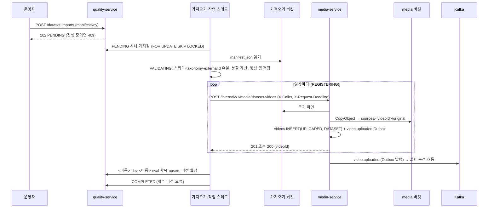

# Plan: SPEC-030 외부 데이터셋 가져오기·특징 내보내기·성능 Gate — backend

- spec: docs 레포 `docs/specs/SPEC-030-quality-datasets/spec.md`
- 계약: docs 레포 `service-contracts/openapi/quality-service.yaml` 3.0.0(가져오기 3개, 내보내기 2개, 내부 성능 Gate 1개, `GoldenSet.origin`), `openapi/media-service.yaml` 1.4.0(`registerDatasetVideo`), `quality/v1/{dataset-import-manifest,golden-manifest,feature-row}.schema.json`, `aggregates/v1/source-result.schema.json`, `events/{source.completed,video.uploaded}.schema.json` (계약 묶음 5.0.0)
- ADR: ADR-0010 ⑨·⑩, ADR-0011(외부 데이터셋은 Golden Set 관리 규칙)
- 선행: SPEC-029 plan(quality-service 모듈, Golden Set 확정, `stage_timings`, `SingleRunLock`, `NameBasedUuid`)

## 1. 요약

- 이 plan은 backend 담당인 quality-service(R-1~R-4, R-7~R-10, R-13~R-18, NFR-1~3)와 media-service(R-5, R-6)만 다룬다. 매칭 규칙(R-11, R-12)과 성능 Gate CI 명령(R-19)은 ai 레포 `evals/` 몫이다.
- quality-service에 기능 패키지 `dataset`(가져오기), `export`(`source.completed` 소비·특징 내보내기)를 더하고, `stage`에 내부 성능 Gate 계산을, `golden`에 데이터셋 항목과 `origin: import` 확정을 더한다.
- 가져오기·내보내기는 비동기다. 요청은 행을 `PENDING`으로 만들고 202로 끝나며, 작업 스레드(전용 실행기 1개)가 DB에서 일을 가져가 처리한다. Pod가 죽으면 다른 Pod가 이어받는다.
- media-service에 기능 패키지 `dataset`을 더해 `POST /internal/v1/media/dataset-videos`를 둔다. 가져오기 버킷의 파일을 media 버킷으로 서버 쪽 복사하고, 결정적 videoId의 영상을 `UPLOADED`·보존 등급 `DATASET`으로 만들며 같은 트랜잭션에서 `video.uploaded`를 Outbox에 넣는다.
- quality → media 호출 클라이언트는 손으로 쓴 RestClient(`MediaDatasetClient`)이고 `X-Caller: quality-service`, `X-Request-Deadline`을 싣는다. 요청 본문은 테스트에서 `media-service.yaml` 요청 스키마로 검증한다(11절 1).
- 새 의존성: openapi-generator(SPEC-029에서 들임). 재시도·서킷브레이커용 Resilience4j는 사용자 확인 필요(10절 1). 마이그레이션: quality 1개, media 1개.

## 2. 담당 요구사항

경로 약어: `Q` = `services/quality-service/src`, `M` = `services/media-service/src`

| 요구사항 | 담당 모듈 / 컴포넌트 | 검증 테스트 |
| --- | --- | --- |
| R-1 | `Q dataset/api/DatasetImportController`, `dataset/application/DatasetImportService#request` | `DatasetImportApiTest` |
| R-2 | `dataset/application/ImportManifestReader`(계약 스키마·`taxonomyVersion`·externalId 유일) | `ImportManifestValidationTest` |
| R-3 | `dataset/domain/DatasetSplitter` | `DatasetSplitterTest` |
| R-4 | `dataset/infra/client/MediaDatasetClient`(RestClient + Resilience4j), `dataset/application/ImportWorker` | `MediaDatasetClientTest`, `DatasetImportFlowTest` |
| R-5 | `M dataset/api/DatasetVideoController`, `dataset/application/DatasetVideoService`, `shared/domain/Video#registerDataset` | `RegisterDatasetVideoApiTest` |
| R-6 | `DatasetVideoService`(있으면 200, 파일 없음 404, 호출자 403) | `RegisterDatasetVideoApiTest`, `ConcurrentDatasetVideoTest` |
| R-7 | `ImportWorker`(영상별 오류, 처음 100건) | `DatasetImportFlowTest` |
| R-8 | `dataset/application/ImportWorker`(→ `golden/application/GoldenDatasetService`·`GoldenFreezeService`) | `DatasetImportFlowTest` |
| R-9 | `DatasetImportService#get·list` | `DatasetImportApiTest` |
| R-10 | `golden/application/GoldenManifestWriter`(`origin: import`), `GoldenDraftService#add`(데이터셋 세트 거절) | `DatasetGoldenManifestTest`, `GoldenDraftApiTest` |
| R-13 | `export/infra/messaging/SourceCompletedListener`, `export/application/SourceResultService` | `SourceCompletedIntakeTest` |
| R-14 | `export/application/FeatureExportService`·`FeatureExportWorker`, `export/domain/FeatureRowMapper`, `golden/application/GoldenSourceService` | `FeatureExportFlowTest`, `FeatureRowMapperTest` |
| R-15 | `export/domain/ExportScope` | `ExportScopeTest`, `FeatureExportApiTest` |
| R-16 | `evaluation/api/InternalEvaluationRunController#evaluateStageGate`, `stage/application/StageGateService` | `StageGateApiTest`, `StageGateCalculatorTest` |
| R-17 | `stage/domain/StageGateCalculator`(`skipped`) | `StageGateCalculatorTest` |
| R-18 | `StageGateCalculator`(`passed`), 저장 없음 | `StageGateApiTest` |
| NFR-1 | `ImportManifestReader`(스트리밍 파싱 + 스키마 검증 한 번) | `ImportManifestPerformanceTest` |
| NFR-2 | `config/{BackgroundJobConfig,BackgroundJobs}`(전용 단일 스레드 실행기) | `ImportIsolationLatencyTest` |
| NFR-3 | `JdbcStageTimingRepository#p95BySources`(`percentile_cont` 한 쿼리) | `StageGateLatencyTest` |

## 3. 원칙 점검

| 원칙 | 준수 | 비고 |
| --- | --- | --- |
| I 스펙 우선 — spec이 Approved 상태인가 | ☑ | SPEC-030 Approved, 머지됨(미결 사항 없음) |
| II 계약 우선 — 계약 변경이 먼저 머지됐는가 | ☑ | `quality-service.yaml` 3.0.0, `media-service.yaml` 1.4.0, `quality/v1` 3종 머지(계약 묶음 5.0.0). 계약 문제는 10절 |
| III 테스트 우선 — 모든 R-*에 테스트가 매핑되고, 태스크가 요구사항 단위 TDD 사이클로 나뉘었는가 | ☑ | backend 담당 R-1~R-10, R-13~R-18, NFR-1~3 매핑 |
| IV 서비스 자율성 — 다른 서비스 DB나 코드에 직접 의존하지 않는가 | ☑ | quality는 media를 계약 API로만, aggregator 결과는 계약 파일(`source-result`)로만 읽는다. pipeline·analysis 등 다른 담당자 서비스는 바꾸지 않는다 |
| V 단순성 — 새 의존성이나 추상화가 정당한가 | ☑ | 비동기 작업은 큐 시스템 없이 DB 행 + 실행기 하나. Resilience4j는 확인 뒤(10절 1) |
| VI 관측 가능성 — 로그, 추적, health를 갖췄는가 | ☑ | 가져오기·내보내기 시작·끝·실패를 importId·exportId로 로그. media 호출에 `traceparent` 전파(RestClient 관측) |
| VII 보안 — 입력 검증, 인가, 비밀값 처리를 했는가 | ☑ | 매니페스트는 계약 스키마로 검증(`..` 금지 경로), media 내부 API는 `X-Caller` 허용 목록, 공개 API는 OPERATOR만 |
| VIII 문서·주석 — spec·계약·plan과 구현이 일치하고, 주석이 왜를 설명하는가 | ☑ | `QualityContractTest`·`MediaContractTest`에 새 작업, 매니페스트·특징 행·`video.uploaded`를 계약 스키마로 검증 |
| IX GitOps — AWS 변경은 infra, 클러스터 변경은 gitops 레포를 거치는가 | ☑ | 가져오기 버킷, media의 그 버킷 읽기 권한, NetworkPolicy는 사용자 지시 시 infra → gitops |

## 4. 기술 설계

### 변경 대상

| 경로 | 변경 |
| --- | --- |
| `Q/main/resources/db/migration/V202611071300__create_dataset_imports_exports.sql` | 가져오기·영상·데이터셋 항목·결과 경로·내보내기 테이블, `golden_sets.dataset_origin` |
| `Q/main/.../dataset/{api,application,domain,infra}/` | 가져오기 |
| `Q/main/.../export/{api,application,domain,infra}/` | `source.completed` 소비, 특징 내보내기 |
| `Q/main/.../golden/application/GoldenDatasetService.java` | 데이터셋 세트 찾기·만들기, 데이터셋 항목 upsert |
| `Q/main/.../golden/application/{GoldenFreezeService,GoldenManifestWriter}.java` | `origin: import` 매니페스트(`datasetItems`·`datasetOrigin`, `entries: []`) |
| `Q/main/.../golden/application/GoldenDraftService.java` | 데이터셋 세트에 검토 항목을 넣으면 409 `QUALITY_GOLDEN_ORIGIN_MISMATCH` |
| `Q/main/.../stage/{api,application,domain}/` | 내부 성능 Gate |
| `services/quality-service/build.gradle.kts` | Resilience4j(retry·circuitbreaker), WireMock(테스트), 계약 스키마 복사 대상 추가 |
| `M/main/resources/db/migration/V202611071300__add_dataset_videos.sql` | `videos.retention_grade` |
| `M/main/.../dataset/{api,application}/` | 데이터셋 영상 등록 |
| `M/main/.../shared/domain/{Video,UploadStorage,RetentionGrade}.java` | `registerDataset` 생성, 가져오기 버킷 크기 확인·복사, 보존 등급 |
| `M/main/.../shared/infra/storage/{MediaStorageProperties,S3UploadStorage}.java` | `import-bucket`, CopyObject |
| `M/main/.../config/{InternalCallerProperties,InternalCallerInterceptor,MediaWebConfig}.java` | `X-Caller` 허용 목록 |

### 데이터 모델 — quality_db

```sql
-- V202611071300__create_dataset_imports_exports.sql
-- 데이터셋 Golden Set의 출처·사용 조건. 가져오기마다 매니페스트 값으로 바꾼다(R-10 datasetOrigin).
ALTER TABLE golden_sets ADD COLUMN dataset_origin JSONB;

CREATE TABLE dataset_imports (
    id            BIGINT GENERATED ALWAYS AS IDENTITY PRIMARY KEY,
    -- uuid5(가져오기 네임스페이스, manifestKey). 같은 매니페스트를 다시 가져오면 같은 importId라
    -- media의 (importId, externalId) videoId가 같아진다(US-1 "같은 videoId가 다시 쓰임"). 10절 확인 항목 2.
    import_id     UUID         NOT NULL UNIQUE,
    manifest_key  VARCHAR(200) NOT NULL UNIQUE,
    dataset_name  VARCHAR(51),
    eval_ratio    DOUBLE PRECISION NOT NULL,
    split_seed    BIGINT       NOT NULL,
    status        VARCHAR(20)  NOT NULL,  -- PENDING | VALIDATING | REGISTERING | COMPLETED | FAILED
    video_count   INT NOT NULL DEFAULT 0,
    registered_count INT NOT NULL DEFAULT 0,
    failed_count  INT NOT NULL DEFAULT 0,
    label_count   INT NOT NULL DEFAULT 0,
    dev_count     INT NOT NULL DEFAULT 0,
    eval_count    INT NOT NULL DEFAULT 0,
    dev_set_id    UUID,
    eval_set_id   UUID,
    dev_version   INT,
    eval_version  INT,
    errors        JSONB        NOT NULL DEFAULT '[]',  -- 처음 100건(R-7)
    requested_by  UUID         NOT NULL,
    -- 작업 스레드가 살아 있다는 표시. 설정 시간보다 오래되면 다른 Pod가 이어받는다.
    heartbeat_at  TIMESTAMPTZ,
    requested_at  TIMESTAMPTZ  NOT NULL,
    finished_at   TIMESTAMPTZ,
    created_at    TIMESTAMPTZ  NOT NULL DEFAULT now(),
    updated_at    TIMESTAMPTZ  NOT NULL DEFAULT now()
);
CREATE INDEX idx_dataset_imports_requested ON dataset_imports (requested_at DESC, id DESC);
CREATE INDEX idx_dataset_imports_work ON dataset_imports (status, heartbeat_at)
    WHERE status IN ('PENDING', 'VALIDATING', 'REGISTERING');

-- 검증을 통과한 영상과 라벨. 이어받은 Pod가 매니페스트를 다시 읽지 않고 남은 영상부터 등록한다.
CREATE TABLE dataset_import_videos (
    id           BIGINT GENERATED ALWAYS AS IDENTITY PRIMARY KEY,
    import_id    BIGINT       NOT NULL REFERENCES dataset_imports (id) ON DELETE CASCADE,
    external_id  VARCHAR(128) NOT NULL,
    path         VARCHAR(420) NOT NULL,
    content_type VARCHAR(40)  NOT NULL,
    split        VARCHAR(10)  NOT NULL,  -- dev | eval (R-3)
    labels       JSONB        NOT NULL,
    status       VARCHAR(20)  NOT NULL,  -- PENDING | REGISTERED | FAILED
    source_id    UUID,
    error_code   VARCHAR(60),
    created_at   TIMESTAMPTZ  NOT NULL DEFAULT now(),
    updated_at   TIMESTAMPTZ  NOT NULL DEFAULT now(),
    UNIQUE (import_id, external_id)
);

-- 데이터셋 Golden Set의 초안 항목(검토 항목 초안과 따로). item_id가 전체에서 유일해
-- 분할이 바뀐 다시 가져오기에서 항목이 dev·eval 두 세트에 함께 남지 않는다.
CREATE TABLE golden_dataset_items (
    id            BIGINT GENERATED ALWAYS AS IDENTITY PRIMARY KEY,
    item_id       UUID         NOT NULL UNIQUE,  -- uuid5(데이터셋 항목 네임스페이스, datasetName + ":" + externalId)
    golden_set_id BIGINT       NOT NULL REFERENCES golden_sets (id),
    external_id   VARCHAR(128) NOT NULL,
    source_id     UUID         NOT NULL,
    import_id     UUID         NOT NULL,
    labels        JSONB        NOT NULL,
    created_at    TIMESTAMPTZ  NOT NULL DEFAULT now(),
    updated_at    TIMESTAMPTZ  NOT NULL DEFAULT now()
);
CREATE INDEX idx_golden_dataset_items_set ON golden_dataset_items (golden_set_id, id);

-- source.completed마다 영상별 최신 결과 파일(R-13). 같은 키(sourceId)는 같은 파티션이라 받은 순서가 최신이다.
CREATE TABLE source_results (
    id          BIGINT GENERATED ALWAYS AS IDENTITY PRIMARY KEY,
    source_id   UUID         NOT NULL UNIQUE,
    job_id      UUID         NOT NULL,
    result_key  VARCHAR(200) NOT NULL,
    received_at TIMESTAMPTZ  NOT NULL,
    received_on DATE         NOT NULL,  -- received_at의 UTC 날짜(R-14 기간)
    created_at  TIMESTAMPTZ  NOT NULL DEFAULT now(),
    updated_at  TIMESTAMPTZ  NOT NULL DEFAULT now()
);
CREATE INDEX idx_source_results_received_on ON source_results (received_on);

CREATE TABLE feature_exports (
    id                 BIGINT GENERATED ALWAYS AS IDENTITY PRIMARY KEY,
    export_id          UUID        NOT NULL UNIQUE,
    status             VARCHAR(20) NOT NULL,  -- PENDING | RUNNING | COMPLETED | FAILED
    golden_set_id      UUID,
    from_date          DATE,
    to_date            DATE,
    file_key           VARCHAR(200),
    row_count          INT         NOT NULL DEFAULT 0,
    source_count       INT         NOT NULL DEFAULT 0,
    requested_by       UUID        NOT NULL,
    heartbeat_at       TIMESTAMPTZ,
    requested_at       TIMESTAMPTZ NOT NULL,
    finished_at        TIMESTAMPTZ,
    created_at         TIMESTAMPTZ NOT NULL DEFAULT now(),
    updated_at         TIMESTAMPTZ NOT NULL DEFAULT now(),
    CONSTRAINT ck_feature_exports_scope CHECK ((golden_set_id IS NULL) <> (from_date IS NULL AND to_date IS NULL))
);
CREATE INDEX idx_feature_exports_work ON feature_exports (status, heartbeat_at)
    WHERE status IN ('PENDING', 'RUNNING');
```

- SPEC-029 R-16의 `video.deleted` 처리에서 그 영상의 `source_results` 행도 지운다(10절 확인 항목 5). `golden_dataset_items`는 지우지 않는다(overview 보존 표: 외부 데이터셋은 삭제 전파 제외).

### 데이터 모델 — media_db

```sql
-- V202611071300__add_dataset_videos.sql
-- SPEC-030 R-5: 외부 데이터셋 영상은 보존 등급 DATASET(ADR-0011, overview 보존 표 외부 데이터셋 행)
ALTER TABLE videos ADD COLUMN retention_grade VARCHAR(20) NOT NULL DEFAULT 'STANDARD';
```

- videoId = `uuid5(NS_DATASET_VIDEO, importId 소문자 + ":" + externalId)`(`libs/common-core` `NameBasedUuid`). 계약 예시의 videoId가 버전 5다. 영상 행의 `public_id UNIQUE`가 (importId, externalId) 멱등을 보장하므로 두 값을 따로 저장하지 않는다.
- 파일 이름은 `importKey`의 마지막 경로 조각이다(표시용, 255자 이하). `expires_at`은 업로드 기한이 없으므로 등록 시각으로 둔다.

### 가져오기 흐름 (R-1~R-4, R-7~R-9)



1. **요청(R-1)**: `importId = uuid5(manifestKey)`. 행이 없으면 `PENDING`으로 만들고, 있고 `COMPLETED`·`FAILED`면 개수·오류·버전을 비우고 `PENDING`으로 되돌린다. `PENDING`·`VALIDATING`·`REGISTERING`이면 409 `QUALITY_IMPORT_IN_PROGRESS`. 행 잠금(`FOR UPDATE`) 안에서 판단해 동시 요청도 하나만 접수한다. 응답은 202 `DatasetImport`(`datasetName: null`).
2. **가져가기**: `ImportWorker`가 2초마다 `status = 'PENDING' OR (진행 중 AND heartbeat_at < now − 5분)`인 행 하나를 `FOR UPDATE SKIP LOCKED`로 잡고 전용 실행기(스레드 1개, NFR-2)에서 처리한다. 처리 중에는 영상 하나를 등록할 때마다 `heartbeat_at`을 갱신한다(media 호출 1건은 최대 read 60초 × 3회라 5분보다 짧다).
3. **검증(R-2, NFR-1)**: 매니페스트 파일이 없으면 `FAILED`, 오류 `QUALITY_IMPORT_MANIFEST_NOT_FOUND`. Jackson으로 한 번 읽어 json-schema-validator로 `dataset-import-manifest.schema.json` 검증(오류 `QUALITY_IMPORT_MANIFEST_INVALID`, 처음 100개 위치·메시지), `taxonomyVersion`이 설정 `vlm.quality.dataset.supported-taxonomy-versions`(기본 `[v2]`)에 없으면 `QUALITY_IMPORT_TAXONOMY_UNSUPPORTED`, 같은 externalId가 둘 이상이면(계약 설명 "데이터셋 안에서 유일") `QUALITY_IMPORT_MANIFEST_INVALID`. 실패하면 영상을 등록하지 않는다.
4. **분할(R-3)**: `DatasetSplitter`가 `SHA-256(UTF-8 문자열 splitSeed + ":" + externalId)`의 앞 8바이트를 부호 없는 정수로 보고 2^64로 나눈 값이 `evalRatio`보다 작으면 `eval`. 영상 행에 분할·라벨을 저장하고 `REGISTERING`으로 바꾼다.
5. **등록(R-4, R-7)**: `PENDING` 영상마다 media를 부른다. `importKey` = 매니페스트 폴더(`imports/<폴더>/`) + `path`. 201·200이면 `REGISTERED`와 videoId(=sourceId). media 404는 `QUALITY_IMPORT_VIDEO_NOT_FOUND`, 400은 `QUALITY_IMPORT_VIDEO_REJECTED`, 재시도 뒤에도 503·연결 실패·시간 초과면 `QUALITY_IMPORT_MEDIA_UNAVAILABLE`로 그 영상만 `FAILED`. 오류는 처음 100건만 남기고 개수는 모두 센다.
6. **Golden Set(R-8, R-10)**: 등록된 영상이 하나도 없으면 `FAILED`. 있으면 분할마다 `<datasetName>-<split>` 세트를 찾거나 `origin: import`로 만든다. 같은 이름의 `origin: review` 세트가 있으면 `FAILED`, 오류 `QUALITY_GOLDEN_ORIGIN_MISMATCH`. 등록된 영상의 라벨을 `golden_dataset_items`에 upsert(item_id 기준, 세트·sourceId·importId·라벨을 바꿈)하고, 그 분할에 이번 가져오기 항목이 있으면 SPEC-029 확정 절차로 새 버전을 만들어 `dev_version`·`eval_version`에 적는다. 항목이 없는 분할은 확정하지 않는다(버전 null).
7. **끝(R-9)**: `COMPLETED`, `finished_at`. 상태 조회는 계약 `DatasetImport`의 `counts`·`goldenSets`·`errors`를 행에서 그대로 만든다. 목록은 `requested_at` 내림차순.

### 데이터셋 Golden Set 매니페스트 (R-10)

- `origin: import`, `entries: []`, `datasetItems`(itemId·externalId·sourceId·importId·labels), `datasetOrigin`(매니페스트 `origin`의 name·license·url). 근거 프레임 복사는 하지 않는다(라벨 대상은 media에 남는 영상 자체).
- 버전 행 `entry_count`는 `datasetItems` 수다(계약 `GoldenSetVersion.entryCount` 최소 1).
- 데이터셋 세트(`origin: import`)에 `addGoldenSetEntry`를 부르면 409 `QUALITY_GOLDEN_ORIGIN_MISMATCH`(SPEC-029 `GoldenDraftService#add`에 조건 추가).

### media 등록 (R-5, R-6)

1. `InternalCallerInterceptor`: `/internal/**`에서 `X-Caller`가 `vlm.media.internal.allowed-callers`(기본 `quality-service`)에 없으면 403 `MEDIA_CALLER_NOT_ALLOWED`.
2. videoId 계산 → 행이 있으면 복사·발행 없이 200 `DatasetVideo`(현재 상태).
3. 가져오기 버킷 `HeadObject`. 없으면 404 `MEDIA_IMPORT_OBJECT_NOT_FOUND`. 크기·형식은 기존 `VideoFilePolicy`(SPEC-003 R-4·R-5)로 검사해 400(10절 계약 문제 1·2).
4. `CopyObject`(가져오기 버킷 → media 버킷 `sources/<videoId>/original`). 트랜잭션 밖에서 한다. 같은 videoId는 같은 경로라 다시 시도해도 같은 결과다.
5. 한 트랜잭션: `Video.registerDataset(...)`(`UPLOADED`, `uploadedAt`, `DATASET`) 저장 + `VideoUploaded.of(video, now)` Outbox. 동시에 같은 요청이 와서 `public_id` 고유 제약에 걸리면 진 쪽 트랜잭션은 되돌아가고(이벤트도 없음) 다시 읽어 200.
6. 보존 등급 `DATASET`은 이번에는 저장만 한다. 삭제·보존 정리 동작을 바꾸는 요구사항은 spec에 없다(10절 확인 항목 4).

### quality → media 호출

- `MediaDatasetClient`는 손으로 쓴 RestClient다(JDK HttpClient, HTTP/1.1 고정). connect 2초, read 60초(서버 쪽 복사 시간). 요청마다 `X-Caller: quality-service`, `X-Request-Deadline: now + read 타임아웃`(epoch ms).
- 재시도: 등록은 videoId가 결정적이라 다시 불러도 같은 결과다. 그래서 5xx·연결 실패에만 지수 백오프(500ms부터)로 최대 3회 시도한다. 4xx는 재시도하지 않는다. 서킷은 최근 10건 중 50% 이상 실패하면 30초 동안 열리고, 열린 동안의 영상은 `QUALITY_IMPORT_MEDIA_UNAVAILABLE` 오류로 남는다(Resilience4j 2.4.0 core, 프로그래밍 방식).

### source.completed 소비 (R-13)

- 리스너 `quality-export` / 그룹 `quality-service`. 계약 스키마 검증 뒤 `source_results`를 `source_id`로 upsert(`job_id`, `result_key`, `received_at = 받은 시각`, `received_on = UTC 날짜`). 삭제 흔적(`deleted_sources`)이 있으면 무시한다.

### 특징 내보내기 (R-14, R-15)

- 요청 검증(`ExportScope`): goldenSetId와 기간이 둘 다 있거나 둘 다 없거나, 기간의 한쪽만 있거나, `from > to`, 기간이 90일을 넘으면 400 `QUALITY_INVALID_REQUEST`. 없는 Golden Set은 404 `QUALITY_GOLDEN_SET_NOT_FOUND`. 통과하면 `PENDING` 행과 202.
- 작업(`FeatureExportWorker`, 가져오기와 같은 가져가기 방식, 같은 전용 실행기)
  - Golden Set: 최신 확정 버전 매니페스트를 Golden Set 버킷에서 읽어 `entries[].sourceId`·`datasetItems[].sourceId`를 중복 없이 모은다. 확정 버전이 없으면 영상 0개다. 줄의 `split`은 그 세트의 분할이다.
  - 기간: `received_on BETWEEN from AND to`인 `source_results`. `split`은 null이다.
  - 영상마다 `source_results.result_key`의 결과 파일(`aggregates/v1/source-result`)을 원본 버킷에서 읽어 `risks[]`마다 한 줄을 만든다. 결과 경로가 없거나 파일이 없는 영상은 건너뛰고 `source_count`에 넣지 않는다.
  - 줄 매핑(`FeatureRowMapper`): sourceId·jobId·riskId·riskType·zoneId·status·carriedOver·firstSeenMs는 그대로, `durationMs`는 결과 파일의 영상 길이(`durationMs`, 계약 예시 `firstSeenMs + activeSeconds`와 맞음), `activeSeconds`·`exposureCount`·`exposureSeconds`는 `exposure`에서, `relatedEventCount`는 `relatedEventIds` 수, `forecast`는 같은 riskId의 `forecasts[].forecast`(없으면 null).
  - 임시 파일에 JSON Lines로 쓰고 다 쓰면 `exports/<exportId>/features.jsonl`로 올린다(10절 확인 항목 6 버킷). `COMPLETED`, `file_key`, `row_count`, `source_count`.

### 성능 Gate (R-16~R-18, NFR-3)

- `X-Caller` 허용 목록은 SPEC-029 `InternalCallerInterceptor`를 그대로 쓴다.
- 한 쿼리로 `stage_timings`에서 `started_at >= now − 90일 AND duration_ms >= 0`이고 `source_id`가 기준 목록·후보 목록인 기록을 `(쪽, stage_id)`별로 묶어 개수와 `percentile_cont(0.95)`를 구한다. `stageIds`가 있으면 그 단계만, 없으면 양쪽에 기록이 있는 단계만.
- `StageGateCalculator`: 한쪽 개수 < `minSamples`이면 `skipped`(p95·비율은 계산한 값이나 null), 아니면 `ratio = 후보 p95 / 기준 p95`, `ratio − 1 > maxRegressionRatio`면 `failed`, 아니면 `passed`. 기준 p95가 0이면 비율을 정의할 수 없어 `skipped`. `failed`가 하나도 없으면 `passed: true`. 결과는 저장하지 않는다.
- 음수 `durationMs`는 SPEC-029 R-22와 같이 백분위와 개수에서 뺀다(Gate는 백분위만 쓰므로 표본 수도 같은 기록으로 센다).

### API

- quality-service(SPEC-030의 6개): `createDatasetImport`, `listDatasetImports`, `getDatasetImport`, `createFeatureExport`, `getFeatureExport`, `evaluateStageGate`(내부). `GoldenSet.origin`은 SPEC-029에서 이미 응답에 담는다.
- media-service: `registerDatasetVideo`(내부). media의 기존 API는 손으로 쓴 record와 `MediaContractTest`를 쓰므로 이 작업도 같은 방식을 따른다(한 서비스 안에서 두 방식을 섞지 않음).

### 설정

| 서비스 | 키 | 환경변수 | 기본값 |
| --- | --- | --- | --- |
| quality | `vlm.quality.storage.import-bucket` | `QUALITY_IMPORT_BUCKET` | 없음 |
| quality | `vlm.quality.storage.export-bucket` | `QUALITY_EXPORT_BUCKET` | 없음 |
| quality | `vlm.quality.media.base-url` | `MEDIA_SERVICE_INTERNAL_URI` | `http://localhost:8082` |
| quality | `vlm.quality.media.{connect-timeout,read-timeout}` | — | 2s, 60s |
| quality | `vlm.quality.dataset.supported-taxonomy-versions` | — | `[v2]` |
| quality | `vlm.quality.dataset.heartbeat-timeout`, `vlm.quality.export.heartbeat-timeout` | — | 5m, 5m |
| media | `vlm.media.storage.import-bucket` | `MEDIA_IMPORT_S3_BUCKET` | 없음 |
| media | `vlm.media.internal.allowed-callers` | `MEDIA_INTERNAL_ALLOWED_CALLERS` | `quality-service` |

## 5. 대안과 선택 이유

| 대안 | 장점 | 단점 | 선택 |
| --- | --- | --- | --- |
| 비동기 작업을 DB 행 + 가져가기(SKIP LOCKED) | 새 인프라 없음, Pod가 죽어도 이어받음, 여러 Pod에서 하나만 처리 | 2초 폴링 지연 | ☑ |
| 요청 스레드에서 `@Async`로 바로 실행 | 지연 없음 | Pod가 죽으면 작업이 사라짐 | |
| Kafka 내부 토픽으로 작업 전달 | 확장성 | 토픽·소비자 추가, 상태는 어차피 DB | |
| importId를 manifestKey로 결정적 | 같은 매니페스트를 다시 가져오면 같은 videoId(US-1) | 같은 경로의 가져오기 이력이 한 행에 덮임 | ☑ |
| 요청마다 무작위 importId | 이력이 모두 남음 | 다시 가져오면 videoId가 달라 영상이 두 번 등록됨(US-1 위반) | |
| media 서버 쪽 CopyObject | 파일이 서비스를 거치지 않음 | 두 버킷이 같은 S3 끝점·권한이어야 함 | ☑ |
| quality가 내려받아 media 업로드 주소로 올림 | 버킷 권한 분리 | 5GB 파일이 quality를 거침, 계약과 다름(R-5는 media가 복사) | |

## 6. 테스트 전략

- **단위**: `DatasetSplitterTest`(고정 시드·externalId의 해시 값, `evalRatio` 0·1), `StageGateCalculatorTest`(3,400 → 4,300ms·0.2면 `failed`, 표본 부족 `skipped`, 기준 0), `ExportScopeTest`, `FeatureRowMapperTest`(계약 `source-result` 예시 → `feature-row` 스키마 통과)
- **통합(quality)**: `@IntegrationTest` + WireMock으로 media를 대신한다(testing.md "외부 서비스 호출은 WireMock"). 매니페스트와 결과 파일은 SeaweedFS에 올린다. `DatasetImportFlowTest`는 영상 2개·라벨 3종 → `COMPLETED`, dev·eval 버전, 하나는 404로 오류 1건
- **통합(media)**: `@IntegrationTest`(PostgreSQL·Kafka·SeaweedFS). 가져오기 버킷을 테스트에서 만들고, `video.uploaded` Outbox payload를 계약 스키마로 검증
- **동시성**: `ConcurrentDatasetVideoTest`(같은 요청 5건 동시 → 영상 1개, Outbox 1건), 가져오기 중복 요청 → 202 1건, 409 나머지
- **계약**: `QualityContractTest`에 6개 작업, `MediaContractTest`에 `registerDatasetVideo` 201·200·400·403·404. `MediaDatasetClientTest`는 WireMock에서 받은 요청 본문을 `media-service.yaml` 요청 스키마로 검증
- **비기능**: `ImportManifestPerformanceTest`(영상 1,000개·라벨 100,000개 검증 10초 이하), `ImportIsolationLatencyTest`(영상 1,000개 가져오기 중 검토 목록 p95 300ms), `StageGateLatencyTest`(영상 200개 × 2, p95 2초)

## 7. 리스크와 롤백

- 리스크: SeaweedFS가 버킷 사이 `CopyObject`를 지원하지 않거나 다르게 동작하면 로컬·테스트가 운영 S3와 달라진다. 첫 media 태스크에서 확인하고, 안 되면 보고한다(다운로드·업로드로 몰래 바꾸지 않음).
- 리스크: 매니페스트 100,000 라벨을 트리로 읽으면 메모리를 수십 MB 쓴다. 가져오기는 한 번에 하나(실행기 1개)라 감당 가능하다. 넘으면 측정값과 보고한다.
- 리스크: 데이터셋 영상도 `video.uploaded`로 일반 분석 흐름을 타므로 pipeline 처리량을 쓴다. 의도한 동작(US-1 "분석이 시작")이다.
- 롤백: 마이그레이션은 추가뿐이다. media의 이전 이미지는 `retention_grade`를 무시한다. quality 롤백 시 진행 중 가져오기는 heartbeat가 끊겨 다시 배포한 Pod가 이어받는다.

## 8. 배포 고려사항

- 환경변수: 4절 "설정" 표. 레포 `.env.example`에 추가하고, docs `local/`(가져오기 버킷 `vlm-imports`, 두 서비스 환경변수, quality 소비 그룹의 `source.completed`)은 docs PR로 한다.
- 순서: media(내부 등록 API) → quality(가져오기). quality를 먼저 올리면 가져오기 영상이 모두 `QUALITY_IMPORT_MEDIA_UNAVAILABLE`로 실패한다.
- 운영: 가져오기 버킷, media의 가져오기 버킷 읽기 권한, quality의 원본 버킷 읽기·Golden Set·내보내기 버킷 쓰기 권한, `/internal/**` NetworkPolicy는 사용자 지시 시 infra → gitops.

## 9. 이 plan이 다루지 않는 것

- R-11, R-12(매칭 규칙), R-19(성능 Gate CI 명령): ai 레포 `evals/` plan.
- 가져오기·내보내기 화면: frontend SPEC-035.

## 10. 확인이 필요한 항목과 spec·계약 문제

1. **(결정됨, D-26) Resilience4j 도입**: 추천안대로 들였다. `resilience4j-retry`·`resilience4j-circuitbreaker` 2.4.0을 `libs.versions.toml`에 고정하고 Spring Boot starter 없이 클라이언트 안에서 직접 구성한다.
2. **(계약 문제) `video/webm`**: 가져오기 매니페스트와 `RegisterDatasetVideoRequest.contentType`은 `video/webm`을 허용하지만, `video.uploaded.contentType`과 media `VideoFilePolicy`(SPEC-003 R-5)는 webm을 허용하지 않는다. 등록하면 계약을 어기는 `video.uploaded`가 나간다. 기본안(C-31)대로 media가 400 `MEDIA_UNSUPPORTED_FORMAT`으로 거절하고 quality는 영상별 오류 `QUALITY_IMPORT_VIDEO_REJECTED`로 남긴다. 계약에서 webm을 뺄지 정하는 docs PR이 필요하다.
3. **(계약 문제) media 400 오류 코드 이름**: `registerDatasetVideo` 400 설명은 `MEDIA_UNSUPPORTED_TYPE`·`MEDIA_FILE_TOO_LARGE`인데 기존 media 코드는 `MEDIA_UNSUPPORTED_FORMAT`·`MEDIA_FILE_SIZE_INVALID`(`createVideo` 계약과 같음)다. 기본안(C-32)대로 기존 코드를 쓴다. 계약 설명을 고치는 docs PR이 필요하다.
4. **(사용자 확인 필요) 보존 등급 `DATASET`의 동작**: 계약 설명은 "삭제 전파와 보존 기간 정리에서 빠진다"지만 spec 요구사항에는 동작이 없다. 소유 운영자가 데이터셋 영상을 지우면 `video.deleted`를 낼지, 지우지 못하게 할지 정해지지 않았다. 결정(D-29)대로 등급을 저장만 하고 삭제 동작은 바꾸지 않았다.
5. **(spec 모호, 확인 권장) 같은 매니페스트 다시 가져오기**: US-1은 같은 videoId를 기대하지만 R-4·R-5는 videoId를 (importId, externalId)로 정하고 R-1은 요청마다 가져오기를 만든다. importId를 manifestKey로 결정적으로 만들어 맞췄다(5절). 그 결과 같은 경로의 가져오기 이력은 한 행에 덮인다. 결정(D-30)대로 이 해석을 따랐다.
6. **(spec 공백, plan에서 정함) 내보내기 파일 버킷**: R-14는 경로 `exports/<exportId>/features.jsonl`만 정하고 버킷은 정하지 않았다. Golden Set 버킷은 Object Lock이라 맞지 않아 별도 설정 `export-bucket`으로 두고, 로컬은 가져오기 버킷과 같은 버킷을 쓴다.
7. **(spec 공백, plan에서 정함) 삭제된 영상의 결과 경로**: `video.deleted`를 받으면 `source_results` 행도 지운다(계약 `video.deleted` "그 sourceId의 데이터를 지운다"). SPEC-029 R-16 목록에는 없다.
8. **(사소한 계약 문서 불일치)** `getDatasetImport` 설명은 "SPEC-030 R-8"(실제 R-9), `createFeatureExport` 설명은 "R-12~R-15"(실제 R-13~R-15)를 가리킨다. 동작에는 영향이 없다.
9. **(계약 공백)** media `registerDatasetVideo`에 `X-Request-Deadline` 헤더와 504가 없다. 기본안(C-33)대로 media는 헤더가 있으면 그 시각까지, 없으면 기본 60초 동안 복사를 기다리고 넘으면 504 `MEDIA_DEADLINE_EXCEEDED`를 낸다. quality는 504를 5xx로 보고 재시도한다. 계약에 헤더와 504를 더하는 docs PR이 필요하다.
10. **(계약 문제) `manifestKey` 패턴**: `CreateDatasetImportRequest.manifestKey` 패턴은 `imports/../manifest.json`처럼 `..` 경로 조각을 막지 않는다. 가져오기 버킷 안의 키라 다른 버킷에 닿지는 않지만, 패턴에서 `.`으로 시작하는 조각을 빼는 docs PR을 권한다.
11. **(계약 문서 불일치)** `source.completed` 스키마의 소비자 목록에 quality-service가 없다. 서비스 카탈로그와 함께 고쳐야 한다(spec 담당 레포 표의 docs 행).

## 11. 구현 중 바뀐 점

1. **media 호출 클라이언트를 생성하지 않고 손으로 썼다.** 문제: quality의 ArchUnit 규칙은 계약 생성 모델(`vlm.contracts..`)을 api 레이어에서만 쓰게 한다. 클라이언트는 infra라 생성 모델을 쓸 수 없다. 선택한 구조: `MediaDatasetClient`(RestClient)가 JSON을 직접 만들고, `MediaDatasetClientTest`가 WireMock이 받은 본문을 `media-service.yaml` 요청 스키마로 검증한다. 이유: 규칙을 완화하지 않고 계약 일치를 테스트로 지킨다.
2. **마이그레이션 시각을 `V202611071300`으로 정했다.** SPEC-029 마이그레이션(최대 `V202611071250`) 뒤에 오도록 맞췄다.
3. **`dataset_imports.dataset_origin` 열을 더했다.** 검증 단계에서 매니페스트의 `origin`을 저장해 이어받은 작업자가 매니페스트를 다시 읽지 않고 Golden Set 매니페스트를 쓴다.
4. **media에 기한·504를 넣었다(C-33).** `X-Request-Deadline`을 읽어 복사 기한으로 쓰고 넘으면 504 `MEDIA_DEADLINE_EXCEEDED`다. 헤더가 없으면 `vlm.media.dataset.default-timeout`(60s)이다.
5. **heartbeat를 30초 주기 대신 영상마다 갱신한다.** 별도 타이머 스레드 없이 등록 결과를 쓸 때 함께 갱신한다. 영상 1건은 최대 180초(read 60초 × 3회)라 5분 기준을 넘지 않는다.
6. **SeaweedFS 테스트 컨테이너에 `-volume.max=64 -master.volumeSizeLimitMB=64`를 준다.** 기본값이면 버킷을 3개 넘게 만들 때 두 번째 버킷부터 put이 500을 돌려준다. 운영 S3에는 해당하지 않는다.
7. **개수 정의**: `counts.labels`는 매니페스트 라벨 전체 수, `counts.dev`·`counts.eval`은 등록에 성공한 영상 중 그 분할의 수다. 가져오기가 끝날 때 영상 행에서 다시 센다. dev·eval 세트는 영상이 한쪽에만 있어도 둘 다 만든다(계약 `goldenSets`가 두 ID를 모두 요구).
8. **성능 Gate를 `InternalEvaluationRunController`에 두었다.** 문제: 생성된 `InternalApi` 인터페이스 하나에 평가 실행 제출과 성능 Gate가 함께 있어 컨트롤러를 둘로 나누면 둘 다 모든 작업을 구현해야 한다. 선택한 구조: 기존 내부 컨트롤러가 `stage/application/StageGateService`를 부르고, 응답은 application 값(`StageGateReport`)으로 받는다. 이유: 기능 경계 규칙(다른 기능의 application만 부름)을 지키고 인터페이스를 고치지 않는다.
9. **내보내기의 Golden Set 영상은 확정 매니페스트에서 읽는다(`golden/application/GoldenSourceService`).** 초안은 확정 뒤에도 바뀌므로 DB 초안이 아니라 Golden Set 버킷의 최신 버전 매니페스트 `entries[]`·`datasetItems[]`의 sourceId를 쓴다. 이를 위해 `GoldenStorage#read`를 더했다.
10. **가져오기와 내보내기는 같은 단일 스레드 실행기에서 번갈아 돈다(`BackgroundJobs`).** 한 바퀴에 각각 하나씩 처리해 긴 가져오기가 내보내기를 오래 막지 않는다.
11. **`.env.example`은 고치지 못했다.** 에이전트 권한 설정이 `.env*` 읽기를 막는다. 새 환경변수는 README 표에 적었다.
